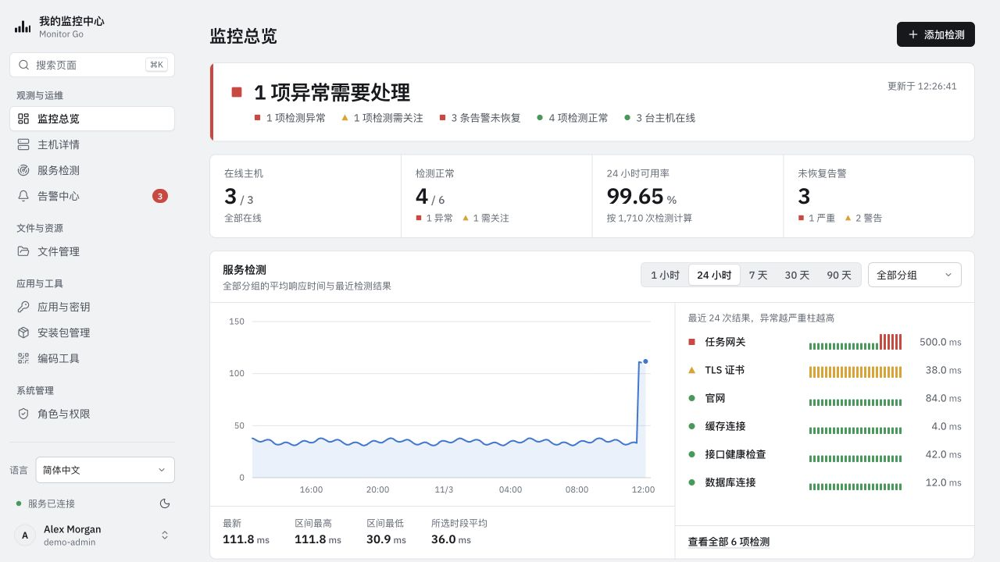
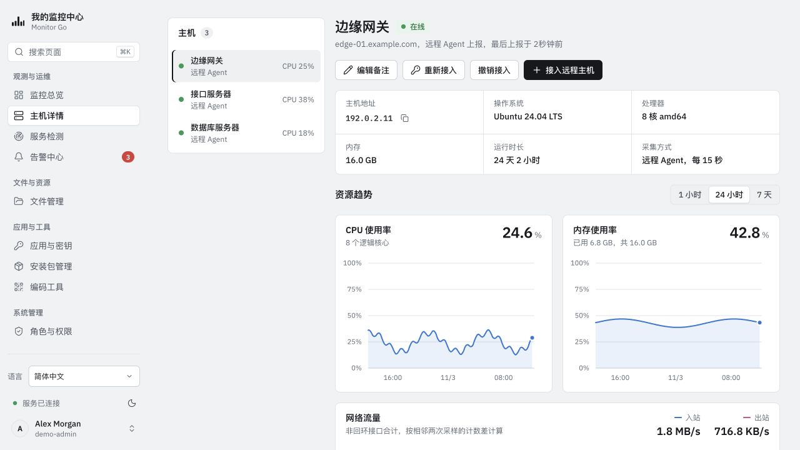
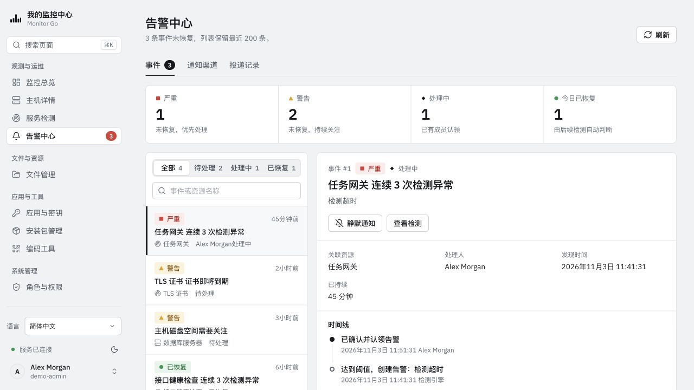
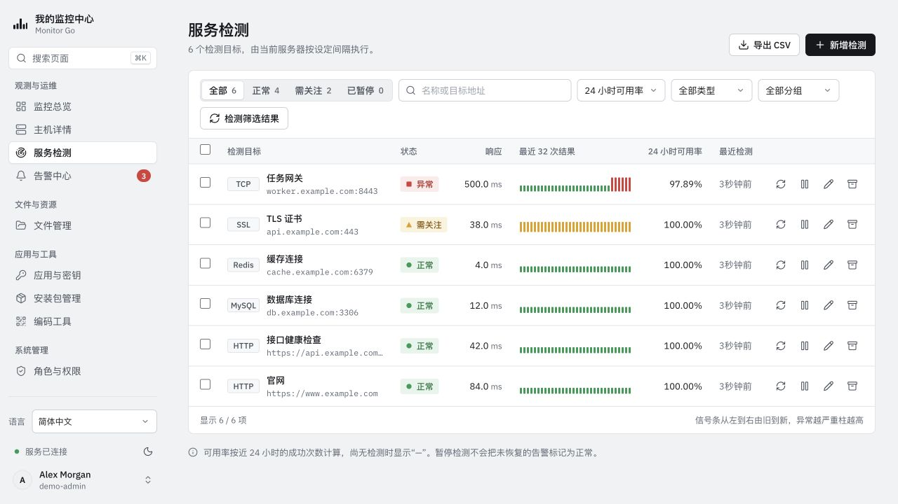
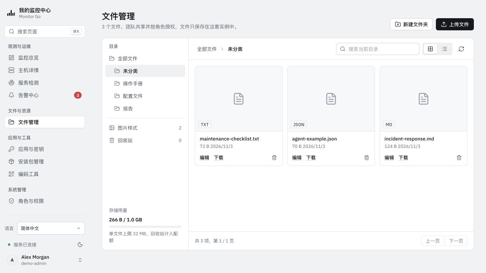
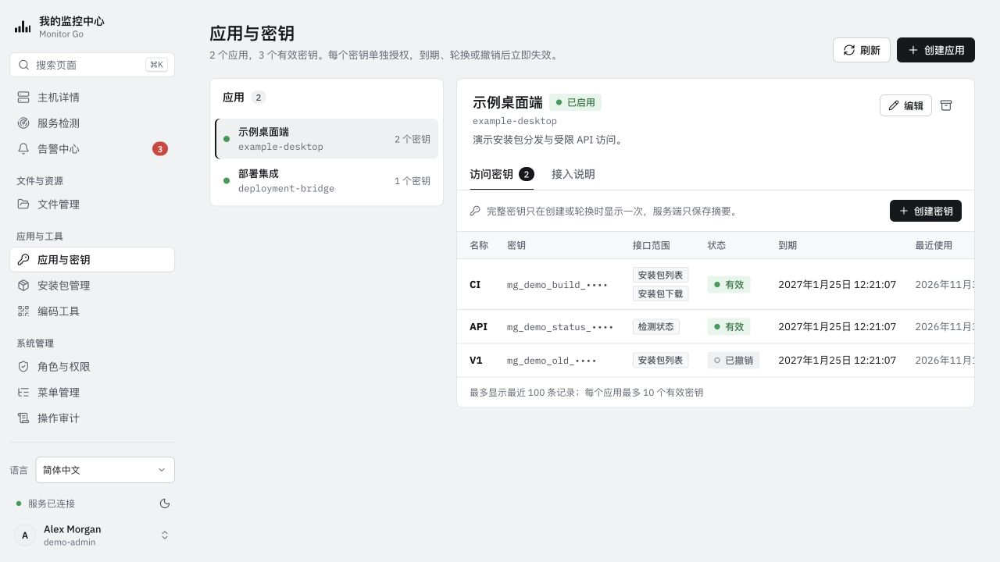
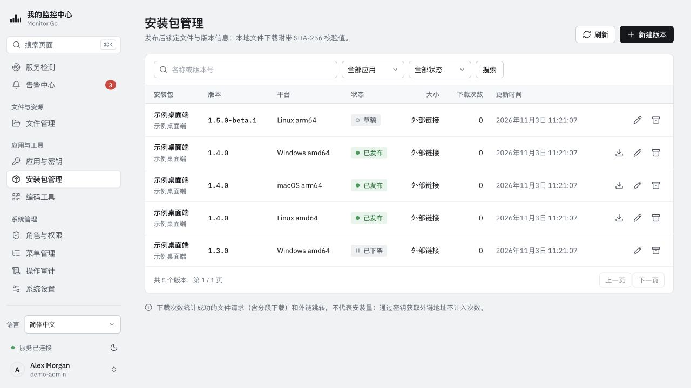
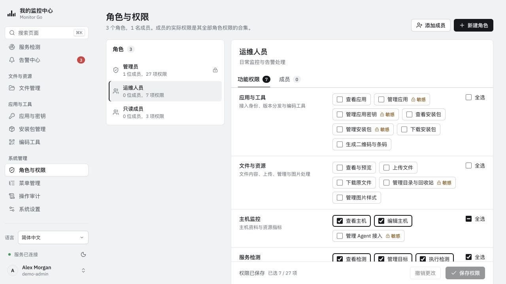
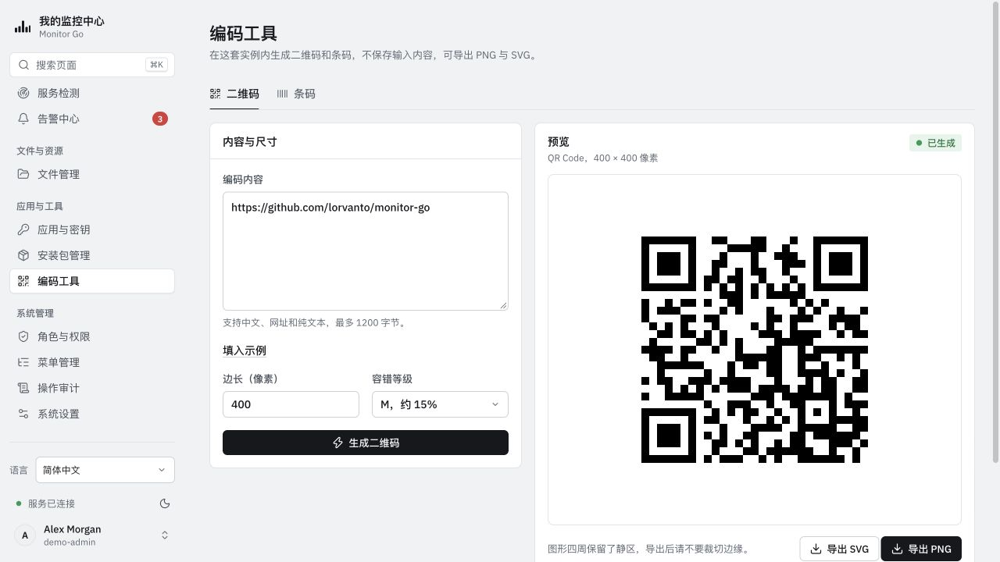

# Monitor Go

基于 **Go、React 19 和 SQLite** 的自托管监控与运维平台。在一套团队共享的实例中监控主机与服务、处理告警，并管理文件、应用密钥和安装包。

**简体中文** · [English](docs/en-US/README.md) · [日本語](docs/ja-JP/README.md) · [한국어](docs/ko-KR/README.md) · [繁體中文](docs/zh-TW/README.md)

**当前状态：**预发布开发基线 `0.4.0-dev`，SQLite 结构版本 `9`。公开发布包和目标平台验证仍在准备中；当前版本号不代表已发布 GitHub Release。详见[完整使用指南](docs/zh-CN/README.md)和[路线图](ROADMAP.md)。

## 功能

| 模块 | 已支持的能力 |
|---|---|
| 监控 | 监控总览、本机与远程主机指标；HTTP、TCP、SSL、MySQL、Redis 服务检测 |
| 告警 | 连续失败阈值、认领、静默、自动恢复和持久化历史 |
| 通知 | SMTP、签名 Webhook、钉钉／飞书／企业微信机器人，持久化重试与投递记录 |
| 团队管理 | 成员、角色、服务端权限校验、自定义导航与操作审计 |
| 文件与应用 | 私有文件存储、图片样式、回收站、限定接口范围的应用密钥与安装包分发 |
| 编码工具 | 二维码以及 Code 128/39、EAN-13/8 条码，支持 PNG／SVG 导出 |
| 界面 | 简体中文、英文、日文、韩文、繁体中文；明暗主题、键盘页面搜索与响应式布局 |

SQLite 是唯一的应用存储。MySQL 和 Redis 是检测对象，无需作为安装依赖。资源在实例内由团队共享，权限由服务端校验，不提供多租户隔离。

程序首次访问默认英文，此后恢复当前浏览器保存的语言选择。默认实例名称和已识别的系统告警文案跟随界面语言；用户填写的名称、备注和原始历史记录保持不变。GitHub 的默认项目介绍与本 README 使用简体中文。

<a id="screenshots"></a>

## 界面截图

以下为实际运行的**简体中文界面**，使用浅色主题与独立的合成演示数据。截图中的主机、指标、文件、应用和告警均为示例，不代表真实监控结果或性能测试。点击图片查看原图。

五语完整图集：[简体中文](docs/zh-CN/SCREENSHOTS.md) · [English](docs/en-US/SCREENSHOTS.md) · [日本語](docs/ja-JP/SCREENSHOTS.md) · [한국어](docs/ko-KR/SCREENSHOTS.md) · [繁體中文](docs/zh-TW/SCREENSHOTS.md)

**监控总览**：集中查看主机健康、服务可用率、响应趋势和待处理告警。

[](docs/assets/screenshots/zh-CN/overview.jpg)

| 主机详情 | 告警中心 |
|---|---|
| [](docs/assets/screenshots/zh-CN/hosts.jpg) | [](docs/assets/screenshots/zh-CN/alerts.jpg) |
| CPU、内存、网络、磁盘和主机信息。 | 严重程度、处理人、静默和恢复记录。 |

| 服务检测 | 文件管理 |
|---|---|
| [](docs/assets/screenshots/zh-CN/service-checks.jpg) | [](docs/assets/screenshots/zh-CN/files.jpg) |
| 检测目标、状态、响应时间和历史可用率。 | 共享目录、上传下载、图片样式与回收站。 |

| 应用与密钥 | 安装包管理 |
|---|---|
| [](docs/assets/screenshots/zh-CN/applications.jpg) | [](docs/assets/screenshots/zh-CN/packages.jpg) |
| 应用标识、脱敏密钥前缀、接口范围与密钥状态。 | 版本、平台、架构、草稿／发布／下架状态与下载记录。 |

演示密钥前缀不能用于访问，演示安装包记录不代表 Monitor Go 已发布版本。

| 角色与权限 | 编码工具 |
|---|---|
| [](docs/assets/screenshots/zh-CN/permissions.jpg) | [](docs/assets/screenshots/zh-CN/code-generator.jpg) |
| 按模块授权，明确标记敏感操作。 | 在实例内生成二维码和条码，支持 PNG／SVG 导出。 |

## Docker 快速启动

使用 Linux 容器、Docker Compose **v2.20+** 和 BuildKit，从源码构建本地镜像：

```sh
git clone https://github.com/lorvanto/monitor-go.git
cd monitor-go
docker compose up -d --build
docker compose exec monitor cat /data/setup-token
```

打开[本地服务](http://127.0.0.1:5080/)，使用初始化令牌创建管理员。命名卷保存 SQLite、密钥和上传文件。若 5080 已被占用，可使用 `MONITOR_PORT=5081 docker compose up -d --build`。

容器以非 root 用户运行，默认关闭容器内主机采集；监控真实主机时接入原生 Agent。`monitor-go:local` 为本地构建镜像，目前没有发布预构建镜像。HTTPS、持久化、备份恢复和升级见 [Docker 部署指南](docs/zh-CN/DOCKER.md)。

## 从源码启动

需要 Go **1.26.9+**（兼容版本）、Node.js **22.12+／24.x**、npm 和 Make。以下命令在 POSIX shell 中执行；Windows 开发者可使用 WSL。

```sh
git clone https://github.com/lorvanto/monitor-go.git
cd monitor-go
make build
./bin/monitor -data data -listen 127.0.0.1:5080
```

打开[本地服务](http://127.0.0.1:5080/)，在本机读取 `data/setup-token`，用它创建首个管理员。没有默认账号或密码；完成初始化后令牌文件会被删除。

`make build` 生成 `bin/monitor` 和 `bin/agent`。服务端内嵌前端，运行时不需要 Node.js、Go 或外部数据库。远程访问、Agent 接入、HTTPS、备份和升级步骤见[完整中文指南](docs/zh-CN/README.md)。

## 开发与验证

```sh
make test
npm --prefix web run format:check
```

测试目标会构建前端、检查类型／翻译目录／文档链接、运行前端交互测试，再执行 Go 竞态测试和 vet。仅修改文档时运行 `npm --prefix web run check:docs`。独立开发环境的启动方法见[贡献指南](CONTRIBUTING.md)。依赖版本固定在 `go.mod`、`go.sum` 与 `web/package-lock.json`。

| 目录 | 用途 |
|---|---|
| `cmd/monitor`、`cmd/agent` | 服务端与 Agent 入口 |
| `internal/app` | 业务模块、授权、SQLite 与迁移 |
| `internal/agent`、`internal/hoststats` | Agent 协议和主机采集 |
| `web/src` | React 页面、共享组件、Zustand 状态与类型工具 |
| `locales` | Go／React 共用的五语消息目录 |
| `scripts`、`web/tests` | 文档／翻译检查与前端测试 |
| `docs/<locale>` | 五语使用指南与截图集，简体中文设计和历史材料另行标注 |
| `docs/assets/screenshots/<locale>` | 按界面语言组织的实拍截图 |
| `.github` | Issue、PR 与发布说明模板 |
| `third_party/licenses` | 第三方依赖许可与署名 |
| `Dockerfile`、`compose.yaml` | 源码容器构建、健康检查与持久卷配置 |

页面按需加载并合并刷新请求；前端静态资源支持 gzip 和条件缓存。主机告警阈值可在系统设置中调整。性能测量、保留策略、登录限制和可信代理配置详见[使用指南](docs/zh-CN/README.md)；合成测试结果不作为生产容量保证。

在线备份命令为 `monitor backup -data data -out backups/snapshot-001`，输出目录必须是新目录且父目录已存在。操作前阅读[备份与恢复说明](docs/zh-CN/README.md)，不要将运行数据提交到 Git。

## 文档与协作

[完整中文指南](docs/zh-CN/README.md) · [文档索引](docs/zh-CN/INDEX.md) · [五语入口](docs/README.md) · [贡献与 GitHub 协作](docs/zh-CN/GITHUB.md) · [项目协作约定](docs/zh-CN/COLLABORATION.md) · [支持](SUPPORT.md) · [安全政策](SECURITY.md) · [变更记录](CHANGELOG.md) · [路线图](ROADMAP.md)

可复现问题请使用 [GitHub Issues](https://github.com/lorvanto/monitor-go/issues) 模板提交；安全漏洞按安全政策私下反馈。历史设计文档含待实施建议，请以当前指南和代码为准。

## 许可证

项目自有代码和文档采用 [Apache License 2.0](LICENSE)。第三方依赖、图标与字体保留各自许可，详见 [NOTICE](NOTICE) 和[第三方声明](THIRD_PARTY_NOTICES.md)。

## 自愿使用情况上报

上报默认关闭，可随时关闭。后台地址已预设为 `https://feiniu.i7f.cn:5090`，无需手动填写；管理员查看目的地与字段并明确同意后，才会登记实例和上报活跃统计。实例统计无需绑定账号；Console 使用本地管理员账号密码登录，GitHub 为可选登录方式。监控、告警和登录不依赖统计后台。[配置、字段及隐私边界](docs/zh-CN/USAGE_REPORTING.md)。
