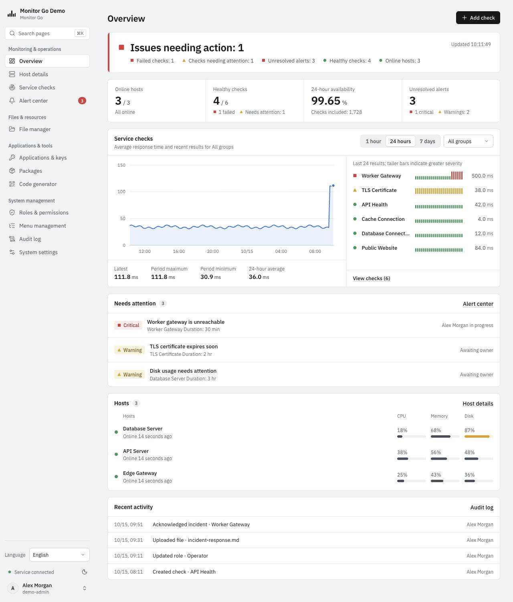
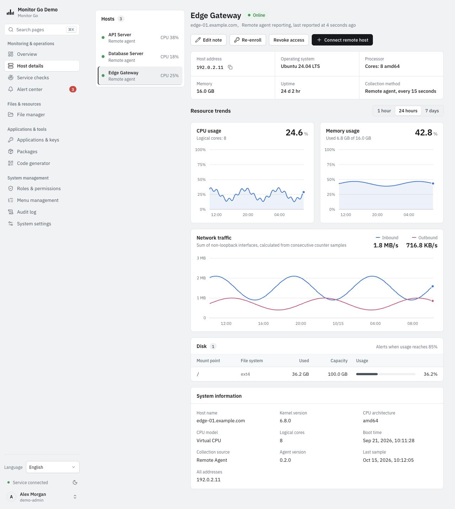
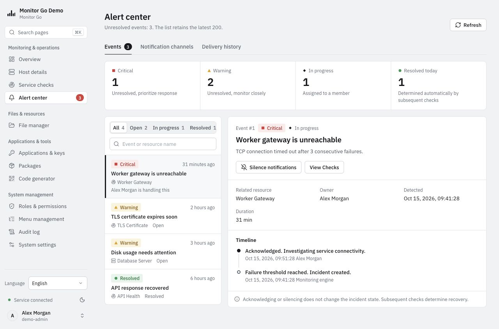
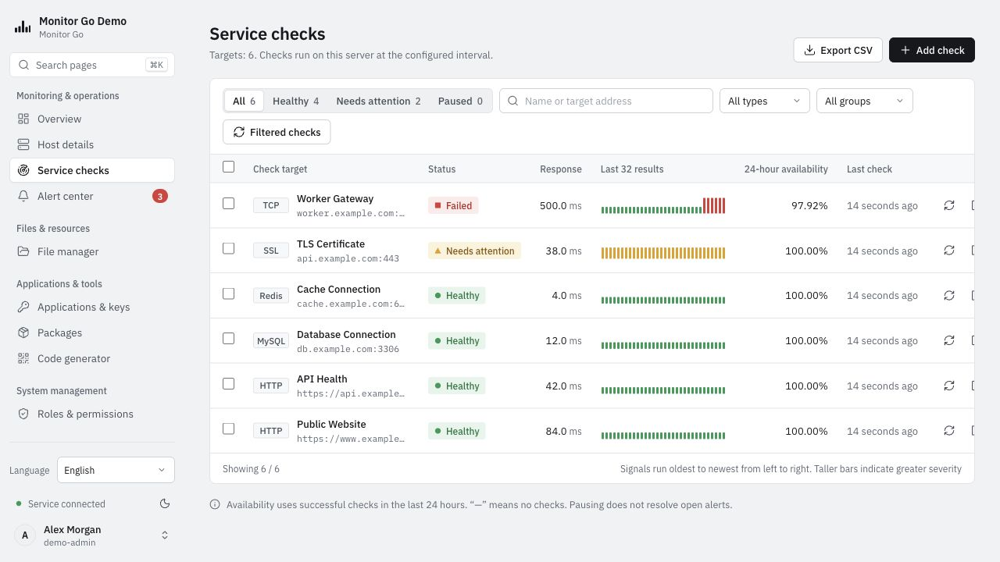
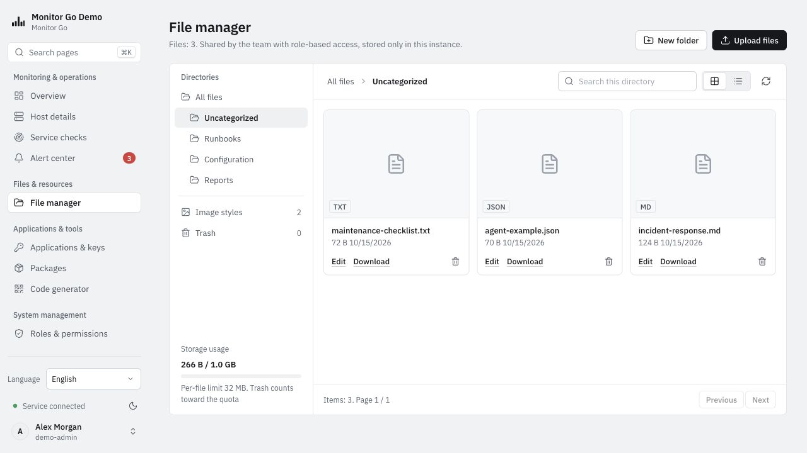
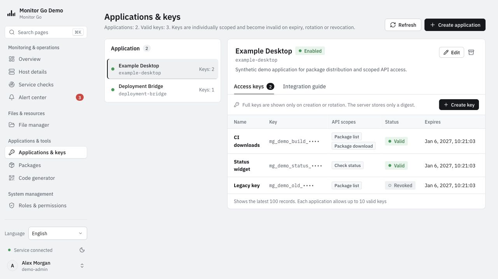
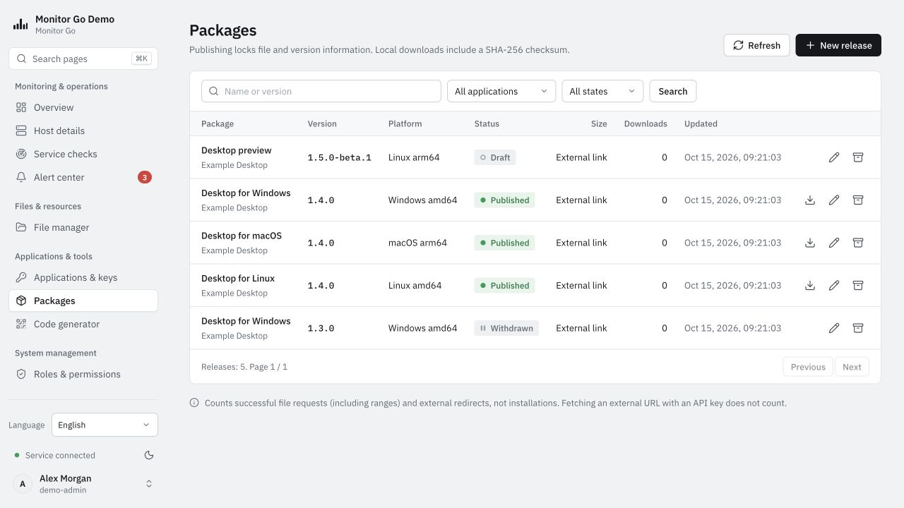
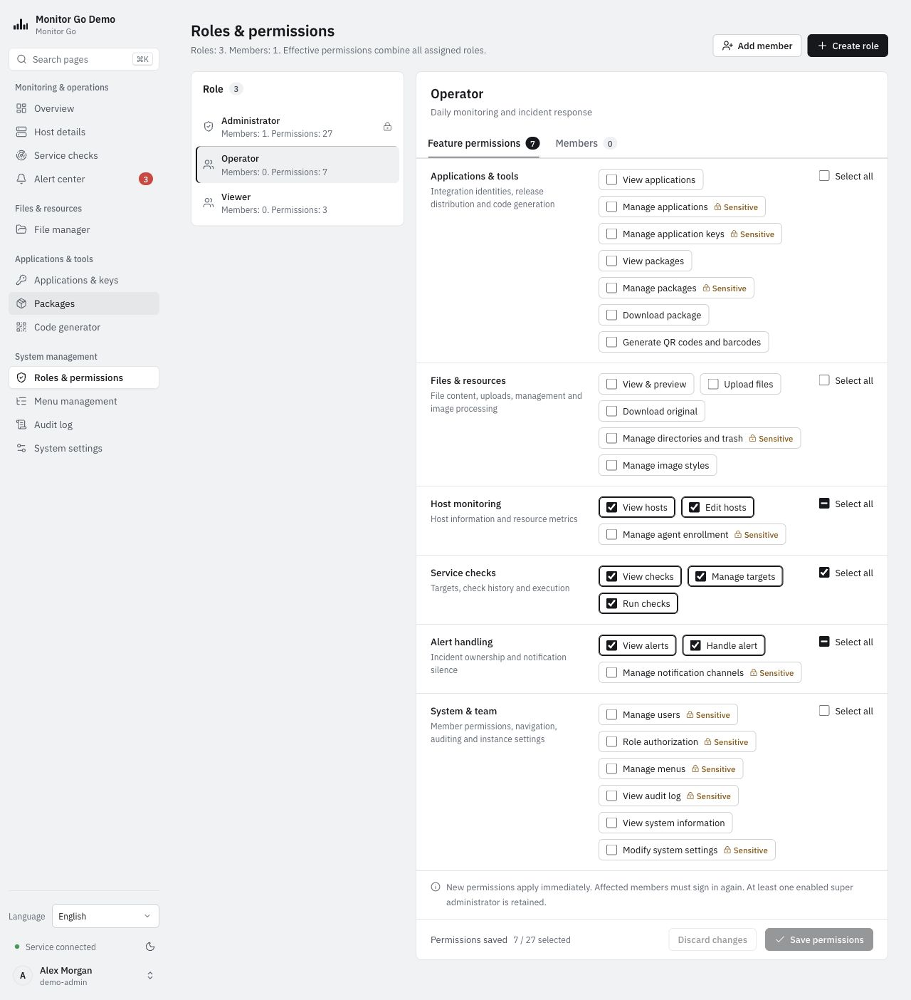
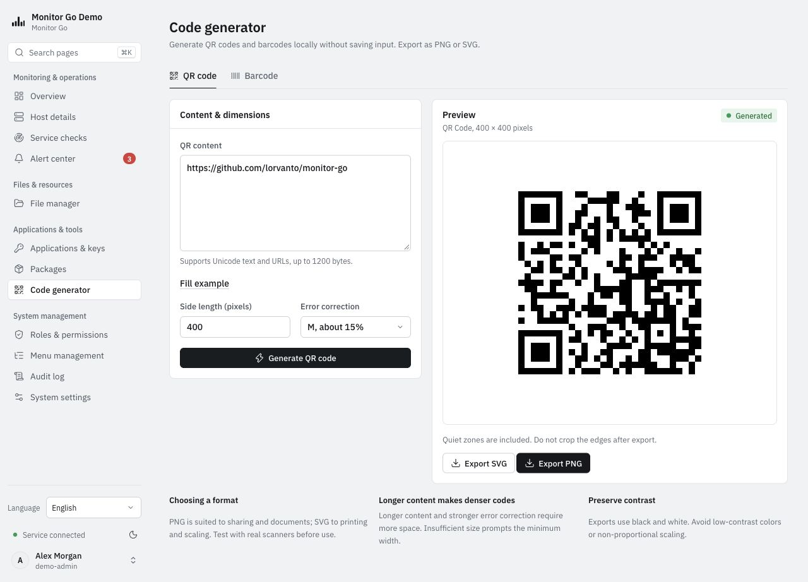

# Monitor Go

A self-hosted monitoring and operations platform built with **Go**, **React 19** and **SQLite**. Monitor hosts and services, manage incidents, and share operational resources within one team installation.

[English guide](docs/en-US/README.md) · [简体中文](docs/zh-CN/README.md) · [日本語](docs/ja-JP/README.md) · [한국어](docs/ko-KR/README.md) · [繁體中文](docs/zh-TW/README.md)

**Status:** pre-release development baseline `0.4.0`, database schema `5`. Public release assets and supported target-platform commitments are still being prepared. See [known limitations](docs/en-US/README.md) and the [roadmap](ROADMAP.md).

## Features

| Area | Available capabilities |
|---|---|
| Monitoring | Overview, local and remote host metrics; HTTP, TCP, SSL, MySQL and Redis checks |
| Incidents | Consecutive-failure thresholds, acknowledgement, silence, automatic recovery and persistent history |
| Notifications | SMTP and signed Webhook delivery, persistent retries and delivery records |
| Team administration | Members, roles, server-enforced permissions, custom navigation and audit logs |
| Files and applications | Private file storage, image styles, trash/restore, scoped application keys and package distribution |
| Utilities | QR codes and Code 128/39, EAN-13/8 barcodes with PNG/SVG export |
| Interface | Five languages with English on first use, light/dark themes, keyboard page search and responsive layouts |

SQLite is the only application datastore. MySQL and Redis are monitored targets, not installation dependencies. Team members share installation resources; this is not a multi-tenant service. Custom names, notes and historical records retain their original language.

## Screenshots

The running application in **English**, the default language on first use, with the light theme. Operational records and metric values below are synthetic demonstration data, not live monitoring results or performance benchmarks. Select a screenshot to open it at full size.

**Overview** — host health, service availability, response trends and incidents in one place.

[](docs/assets/screenshots/overview.jpg)

| Host metrics | Incident response |
|---|---|
| [](docs/assets/screenshots/hosts.jpg) | [](docs/assets/screenshots/alerts.jpg) |
| Remote host inventory and resource history. | Severity, ownership, notification silence and recovery history. |

| Service checks | File manager |
|---|---|
| [](docs/assets/screenshots/service-checks.jpg) | [](docs/assets/screenshots/files.jpg) |
| Targets, status, response time and recent check results. | Shared folders, uploads, downloads, image styles and trash. |

| Applications and keys | Package management |
|---|---|
| [](docs/assets/screenshots/applications.jpg) | [](docs/assets/screenshots/packages.jpg) |
| Application identities, masked key prefixes, API scopes and key status. | Versions, platform and architecture variants, release states and download records. |

The application keys and package versions shown here are synthetic examples; they do not provide working credentials or announce Monitor Go releases.

| Roles and permissions | Code generator |
|---|---|
| [](docs/assets/screenshots/permissions.jpg) | [](docs/assets/screenshots/code-generator.jpg) |
| Role permissions with sensitive actions clearly marked. | QR and barcode tools with local generation and PNG/SVG export. |

## Quick start with Docker

Use Linux containers and Docker Compose v2.20+ with BuildKit. Build the image locally from source:

```sh
git clone https://github.com/lorvanto/monitor-go.git
cd monitor-go
docker compose up -d --build
docker compose exec monitor cat /data/setup-token
```

Open [the local service](http://127.0.0.1:5080/) and create the administrator with that token. The named volume preserves SQLite, keys and uploads. If 5080 is occupied, use `MONITOR_PORT=5081 docker compose up -d --build`. The container runs as a non-root user and local host collection is disabled; enroll native Agents for real hosts. See the [Docker guide](docs/en-US/DOCKER.md) for HTTPS, backups, restoration and upgrades. `monitor-go:local` is built locally; no prebuilt registry image is published.

## Quick start from source

Use Go **1.26.9+** (compatible releases), Node.js **22.12+ / 24.x**, npm and Make. Clone the repository and run these commands in a POSIX shell; Windows developers can use WSL:

```sh
git clone https://github.com/lorvanto/monitor-go.git
cd monitor-go
make build
./bin/monitor -data data -listen 127.0.0.1:5080
```

Open [the local service](http://127.0.0.1:5080/). Read `data/setup-token` locally and use it to create the first administrator. There are no default credentials. Setup removes the token file.

`make build` creates `bin/monitor` and `bin/agent`. The server embeds the web interface; Node.js, Go and external databases are not required at runtime. For remote access, Agent enrollment, HTTPS, backups and upgrades, follow a [current user guide](docs/README.md).

## Development

```sh
make test
npm --prefix web run format:check
```

The test target builds the frontend, checks types/catalogs/documentation links, runs frontend tests, then runs Go race tests and vet. For documentation-only edits, run `npm --prefix web run check:docs` with Node.js.

Start an isolated backend and frontend with the commands in [CONTRIBUTING.md](CONTRIBUTING.md). Dependencies are pinned in `go.mod`, `go.sum` and `web/package-lock.json`.

| Directory | Purpose |
|---|---|
| `cmd/monitor`, `cmd/agent` | Server and Agent entry points |
| `internal/app` | Business modules, authorization, SQLite and migrations |
| `internal/agent`, `internal/hoststats` | Agent protocol and host collection |
| `web/src` | React views, shared components, Zustand stores and typed helpers |
| `locales` | Shared Go/React message catalogs and language negotiation |
| `scripts`, `web/tests` | Documentation/catalog checks and frontend tests |
| `docs/` | Five-language guides, development references, labeled designs and historical evidence, organized by locale |
| `.github` | Issue, pull request and release-note templates |
| `third_party/licenses` | Preserved direct-dependency license and attribution texts |
| `Dockerfile`, `compose.yaml` | Source-built container, health check and persistent volume |

Login limits count failed attempts per client IP and username. Configure `-trusted-proxy` only for known reverse proxies; see the [deployment guide](docs/en-US/README.md#trusted-proxies-and-login-limits).

The default instance name follows the interface language; custom instance names remain unchanged.

Monitor configurations can be fully edited with credential preservation and version checks, or archived with confirmation. See [monitor editing](docs/en-US/README.md#monitor-editing-and-archiving).

## Documentation and community

[User guides](docs/README.md) · [Contributing](CONTRIBUTING.md) · [Collaboration guidelines](AGENTS.md) · [Support](SUPPORT.md) · [Security](SECURITY.md) · [Changelog](CHANGELOG.md) · [Roadmap](ROADMAP.md) · [Release preparation](docs/en-US/RELEASING.md)

Report reproducible bugs using the issue templates in [lorvanto/monitor-go](https://github.com/lorvanto/monitor-go/issues). Use the security policy for private vulnerability reporting. Historical design documents include proposals; they are not a list of shipped features.

## License

Project-owned source code and documentation are licensed under the [Apache License 2.0](LICENSE). See [NOTICE](NOTICE) and [third-party notices](THIRD_PARTY_NOTICES.md) for attribution and separately licensed dependencies, icons and fonts.
