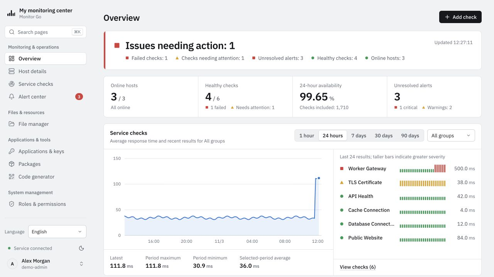
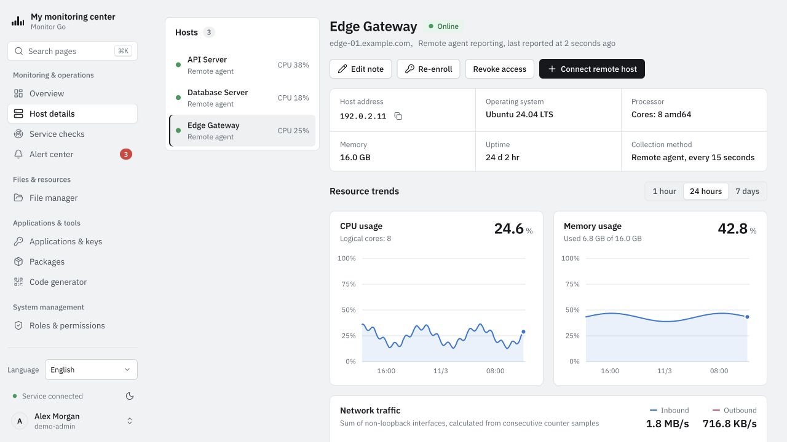
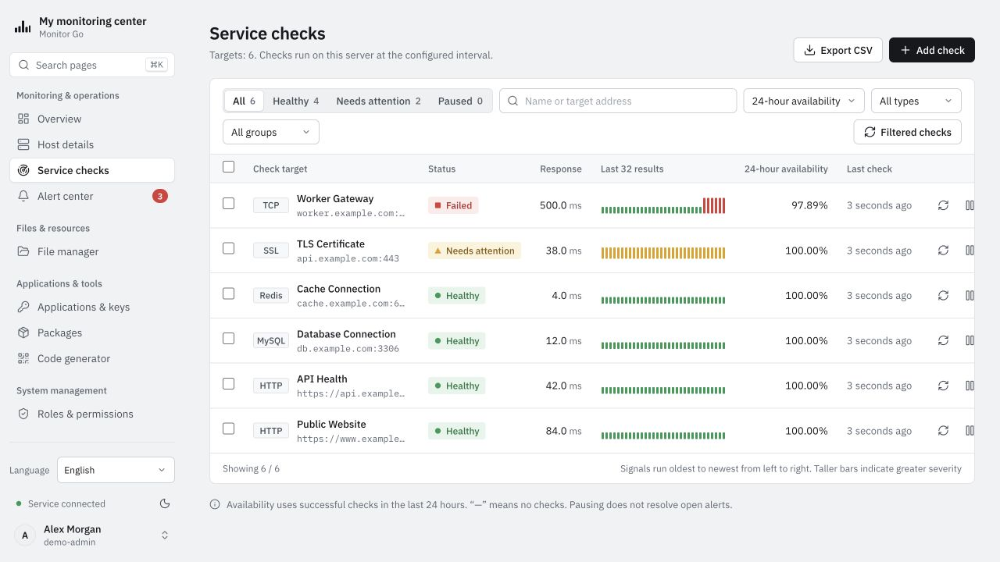
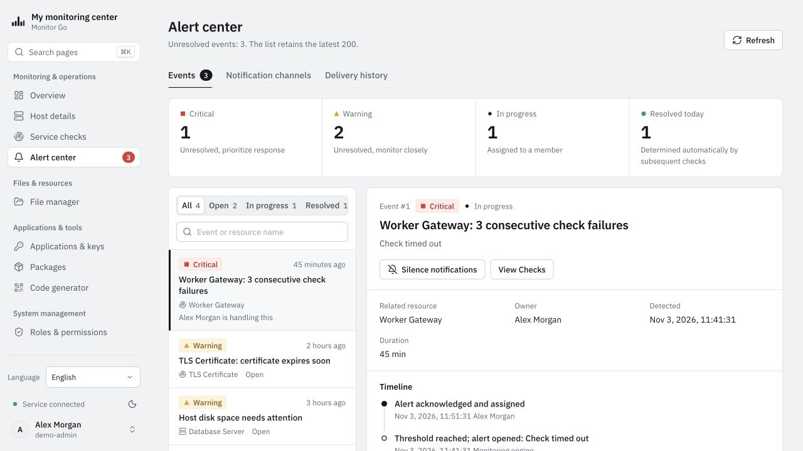
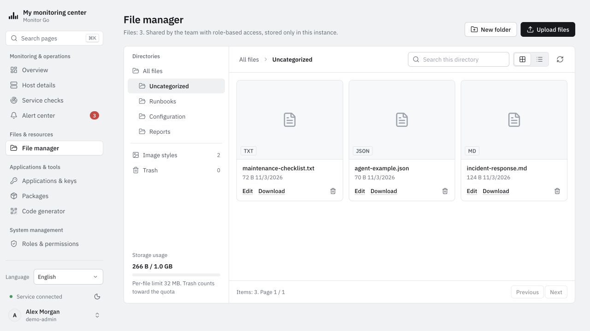
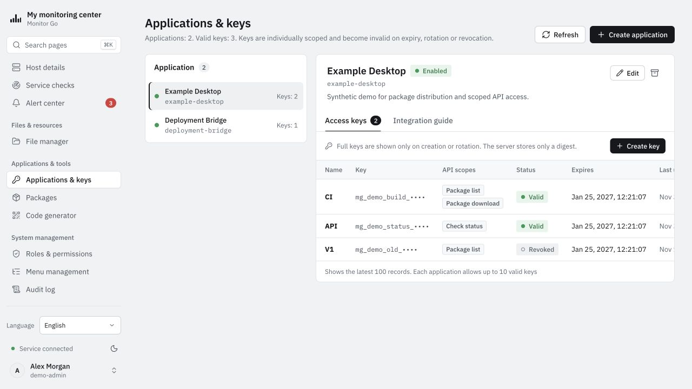
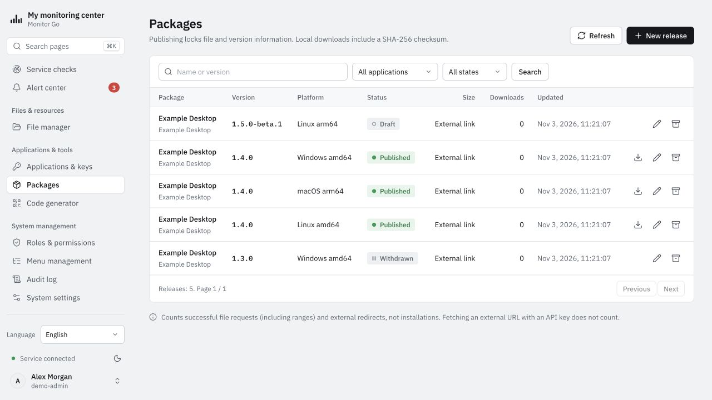
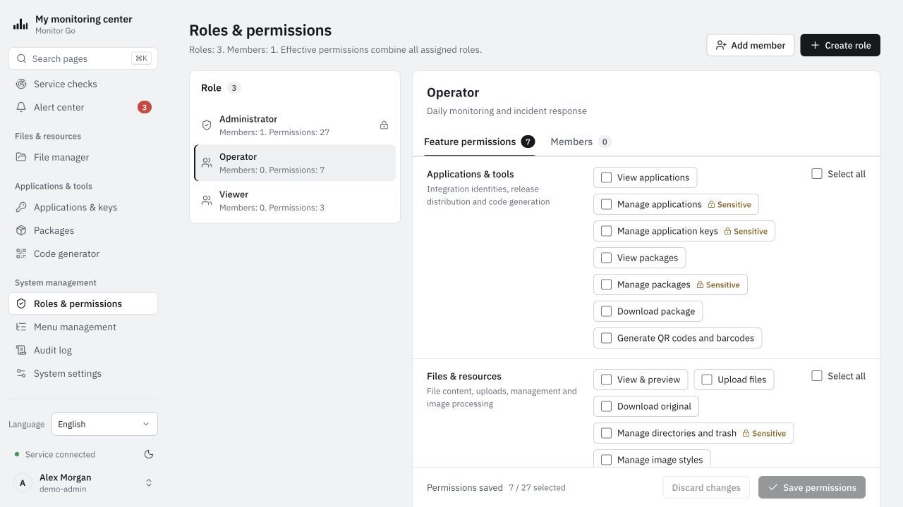
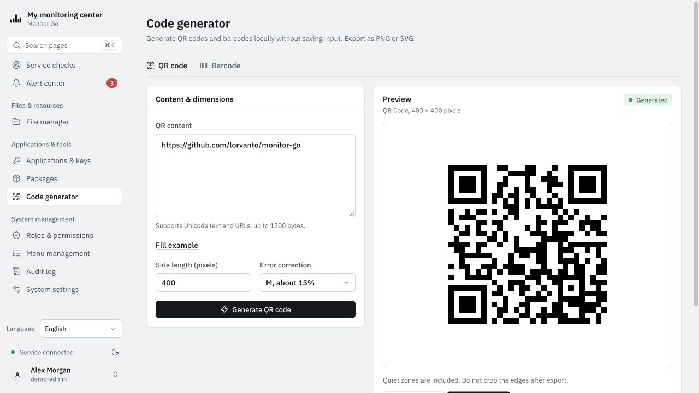

# Monitor Go — Interface screenshots

[简体中文](../zh-CN/SCREENSHOTS.md) · **English** · [日本語](../ja-JP/SCREENSHOTS.md) · [한국어](../ko-KR/SCREENSHOTS.md) · [繁體中文](../zh-TW/SCREENSHOTS.md)

These captures show the running English interface with the light theme and isolated synthetic demonstration data. Hosts, applications, incidents, files and metrics are illustrative, not live results or benchmarks. Key prefixes are not usable credentials, and package records do not announce Monitor Go releases. Select an image to view it at full size.

## Overview

## Host details

## Service checks

## Alert center

## File manager

## Applications and keys

## Packages

## Roles and permissions

## Code generator

[User guide](README.md) · [Capture provenance and maintenance](../assets/screenshots/README.md)
