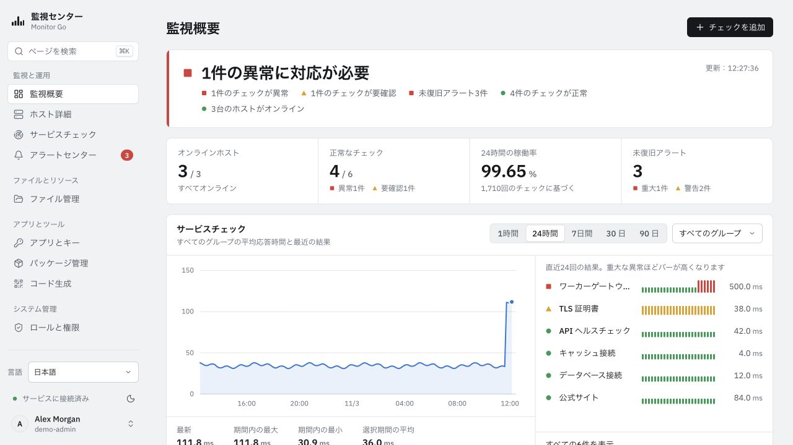
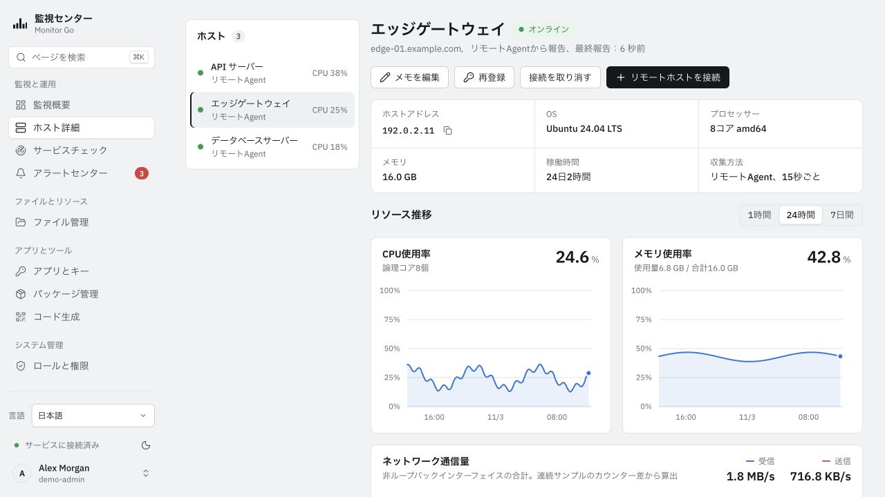
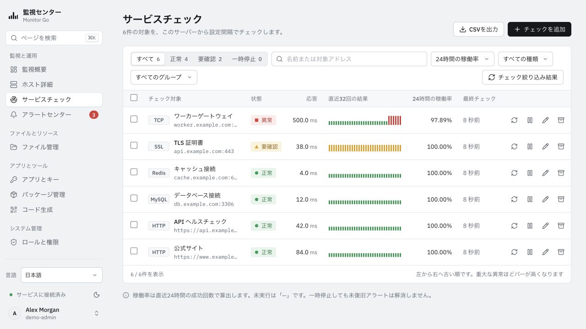
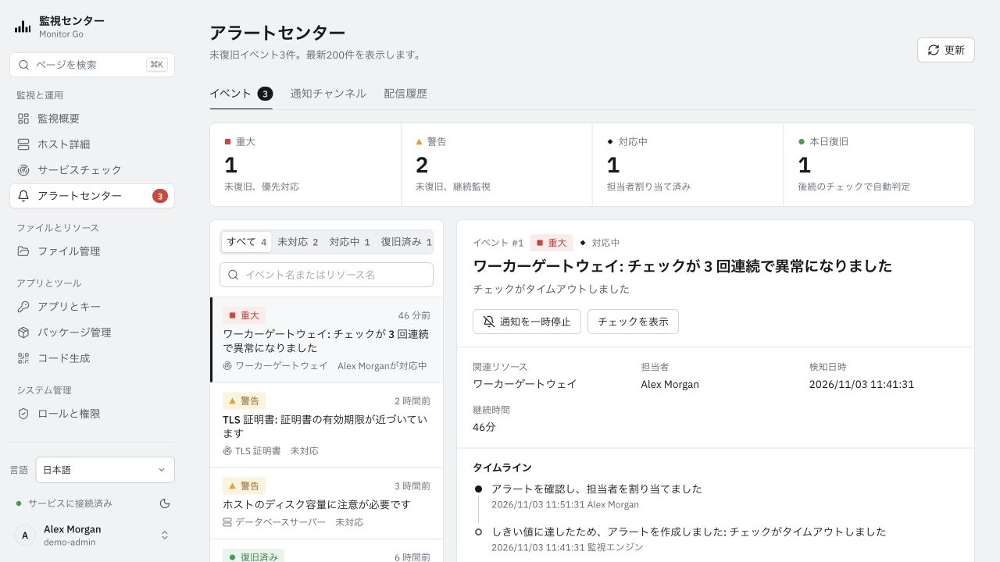
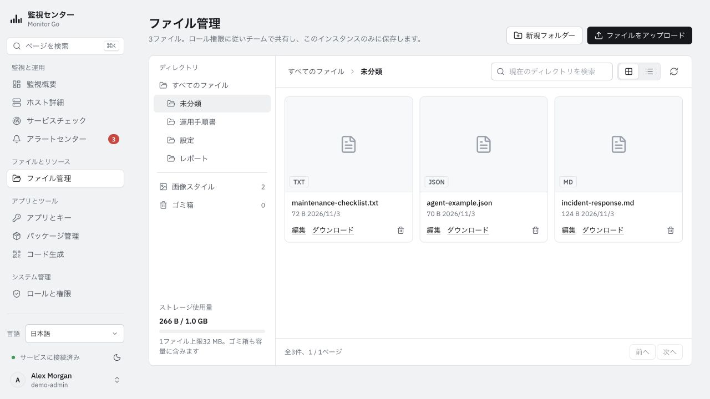
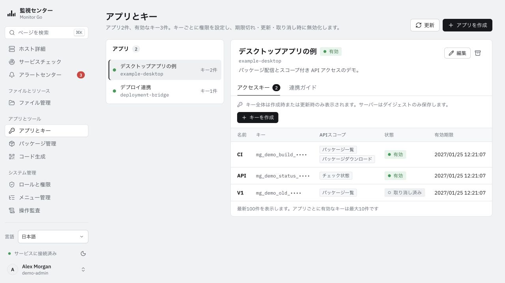
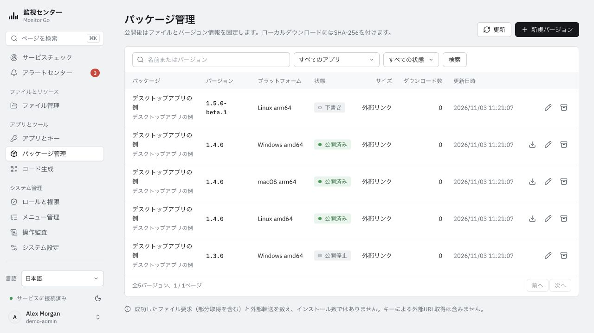
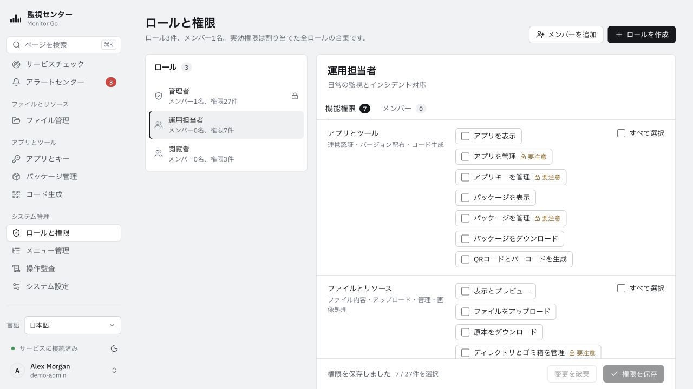
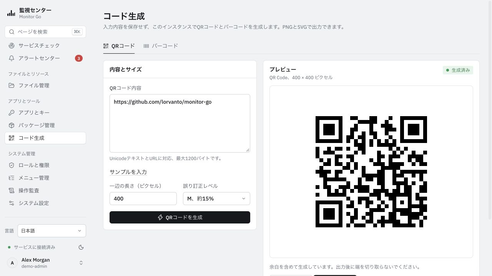

# Monitor Go — 画面のスクリーンショット

[简体中文](../zh-CN/SCREENSHOTS.md) · [English](../en-US/SCREENSHOTS.md) · **日本語** · [한국어](../ko-KR/SCREENSHOTS.md) · [繁體中文](../zh-TW/SCREENSHOTS.md)

実際に動作する日本語 UI をライトテーマで撮影しました。ホスト、アプリケーション、アラート、ファイル、メトリクスは隔離環境の架空データであり、実測結果やベンチマークではありません。キーの接頭辞は認証に使えず、パッケージの記録は Monitor Go の公開リリースを示しません。画像を選択すると原寸で表示します。

## 監視概要

## ホスト詳細

## サービスチェック

## アラートセンター

## ファイル管理

## アプリケーションとキー

## パッケージ管理

## ロールと権限

## コード生成

[利用ガイド](README.md) · [撮影情報と保守](../assets/screenshots/README.md)
