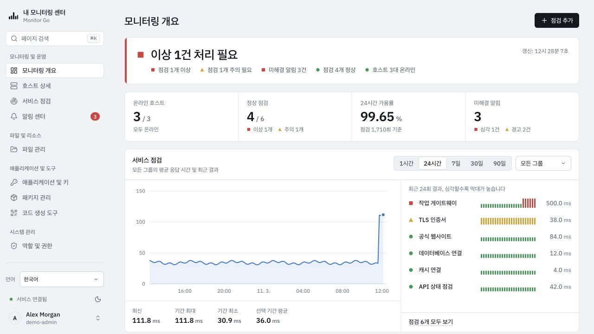
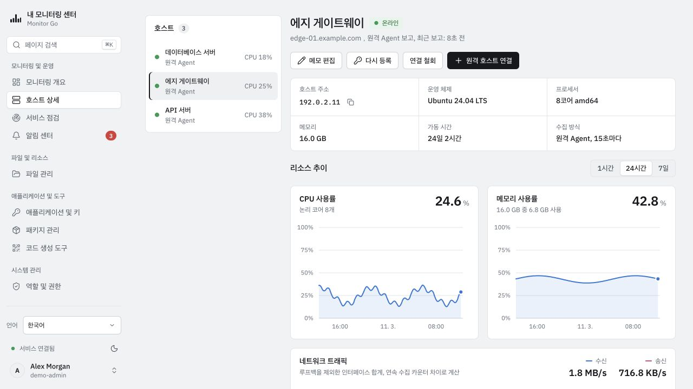
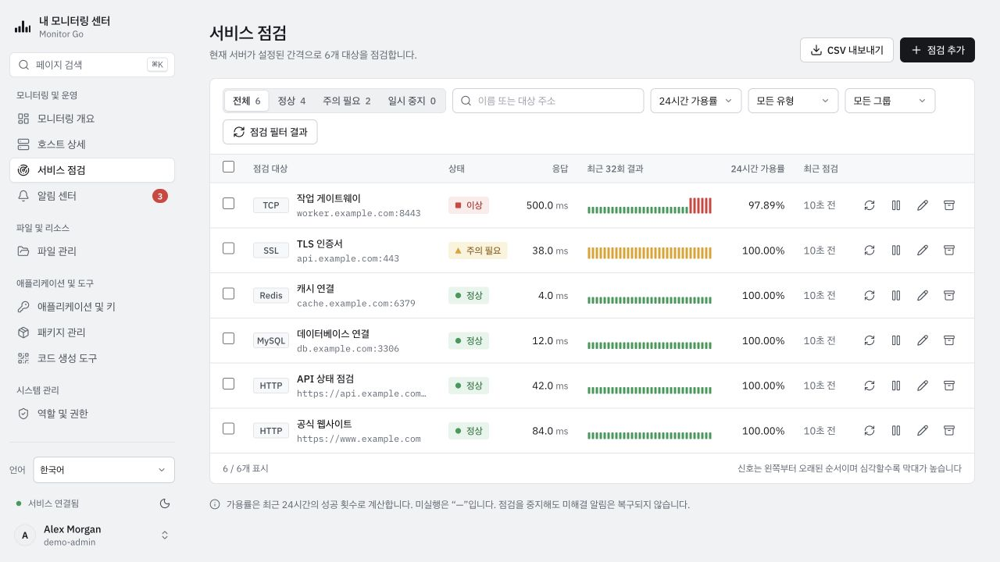
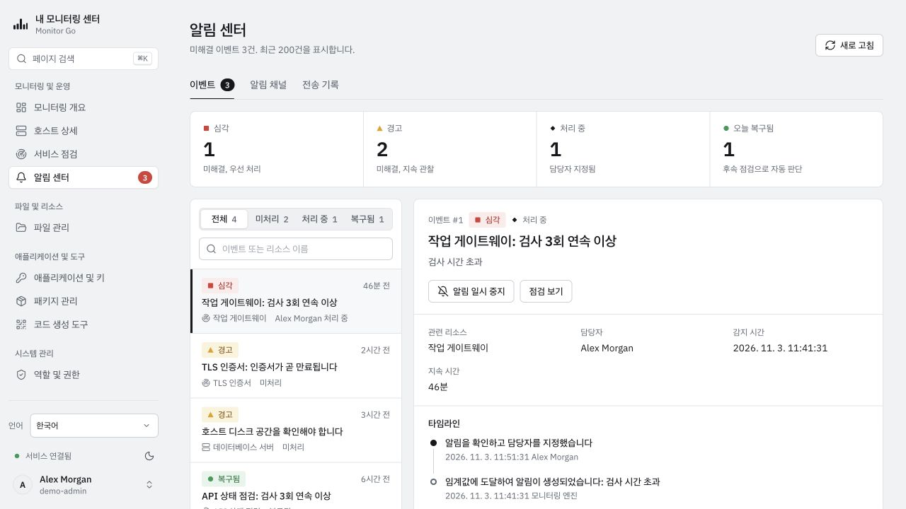
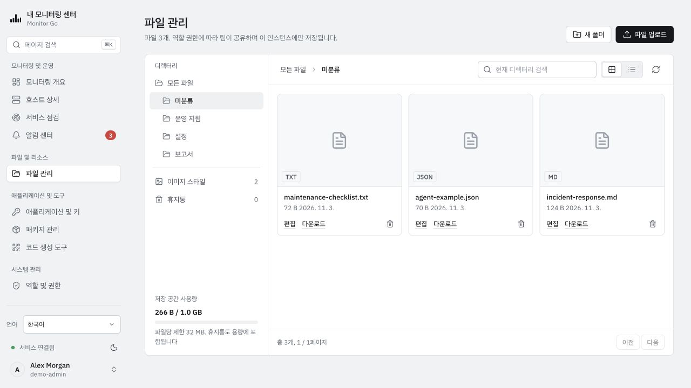
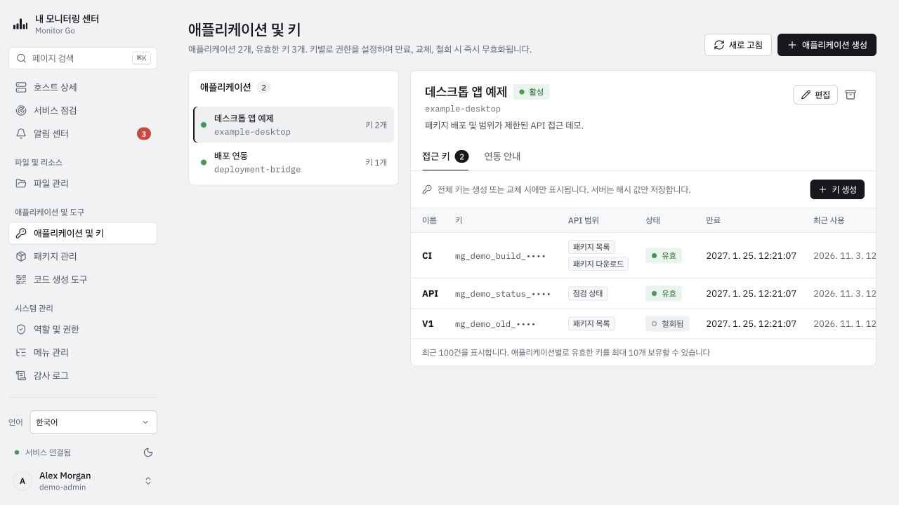
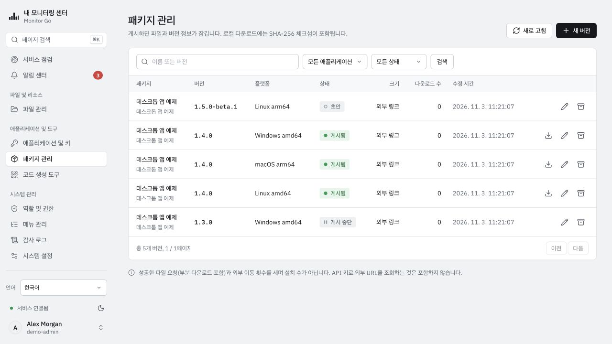
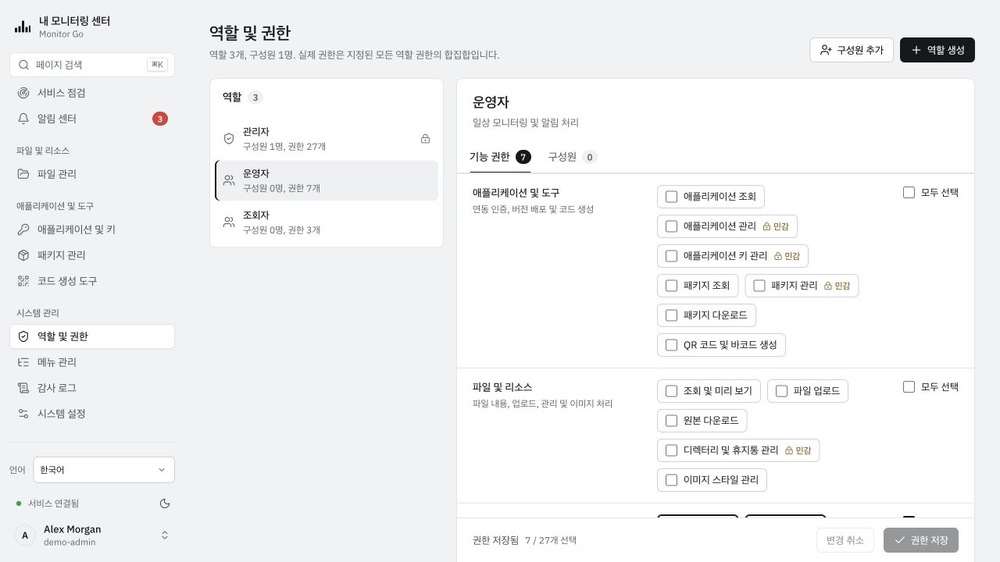
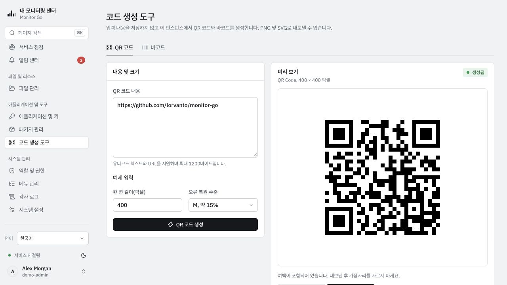

# Monitor Go — 화면 스크린샷

[简体中文](../zh-CN/SCREENSHOTS.md) · [English](../en-US/SCREENSHOTS.md) · [日本語](../ja-JP/SCREENSHOTS.md) · **한국어** · [繁體中文](../zh-TW/SCREENSHOTS.md)

실행 중인 한국어 UI를 밝은 테마로 촬영했습니다. 호스트, 애플리케이션, 알림, 파일 및 지표는 격리된 환경의 가상 데모 데이터이며 실제 모니터링 결과나 벤치마크가 아닙니다. 키 접두사는 인증에 사용할 수 없고 패키지 기록은 Monitor Go의 공개 릴리스를 의미하지 않습니다. 이미지를 선택하면 원본 크기로 볼 수 있습니다.

## 모니터링 개요

## 호스트 상세

## 서비스 점검

## 알림 센터

## 파일 관리

## 애플리케이션 및 키

## 패키지 관리

## 역할 및 권한

## 코드 생성

[사용 안내](README.md) · [촬영 정보 및 유지 관리](../assets/screenshots/README.md)
