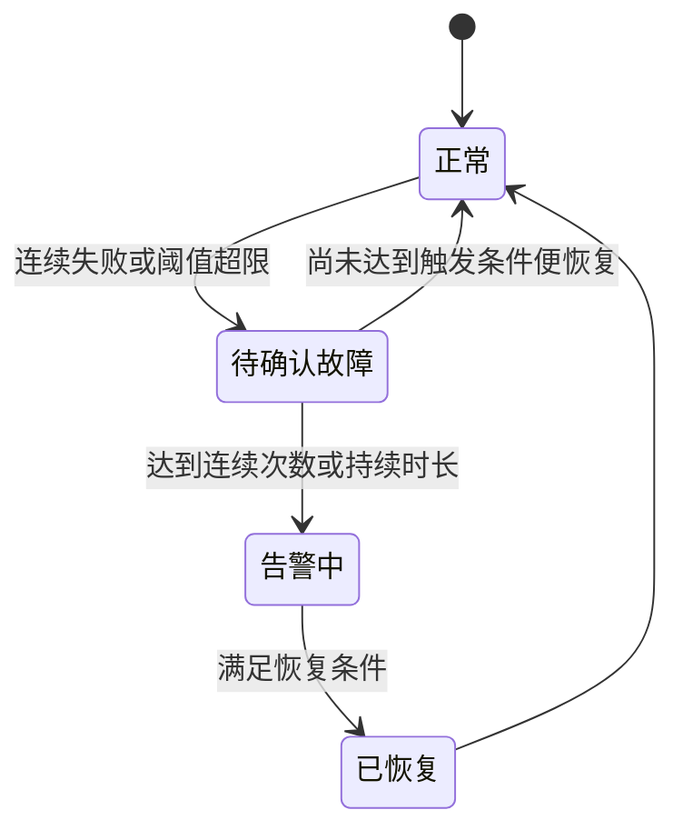

# 接口与运行机制

> 文档类型：实现说明与后续接口建议；按章节标识区分。当前使用方式以 [使用指南](README.md) 为准，公开发布流程见 [GitHub 发布指南](GITHUB.md)。

本文定义完整产品的设计基线。当前实际接口见下表和 `internal/app/server.go`；后文中未列入下表的能力仍为规划。调用方应以本项目实际路由、鉴权规则和签名协议为准。

## 当前实际接口与实现边界

前端 JSON 与上传请求携带 `Accept-Language`。下载和图片链接通过 `lang` 明确当前显示语言；有效 GET/HEAD 参数优先于请求头，并返回 `Content-Language`。不改变鉴权、状态码、业务数据与文件内容。

文件、本地安装包下载与图片接口返回二进制；其余 JSON 接口成功返回 `data`，失败返回 `error.message`，并携带用于界面切换语言的 `error.key` / `error.args`，附带 `request_id`。资源 ID 为字符串，实际时间字段为 UTC Unix 毫秒，前端按浏览器时区显示。此处明确取代下文建议的 RFC3339 时间字段；后续协议变更需统一前后端。

| 接口 | 已实现行为 |
|---|---|
| `GET/POST /api/v1/applications`、`PATCH/DELETE /api/v1/applications/{id}` | 应用目录、创建、版本编辑、归档；管理操作独立授权 |
| `GET/POST /api/v1/applications/{id}/keys`、`DELETE /api/v1/application-keys/{id}` | 密钥元数据、签发/轮换/撤销；需 `application:keys` |
| `GET/POST /api/v1/releases`、`PATCH/DELETE /api/v1/releases/{id}` | 安装包筛选分页与版本管理 |
| `GET /api/v1/releases/{id}/download` | 发布且启用才可下载；需 `release:download` |
| `GET /api/v1/integrations/me`、`hosts`、`monitors`、`alerts`、`releases`、`releases/{id}/download` | 独立 Bearer 身份，固定范围与应用隔离，详情见应用分发文档 |
| `POST /api/v1/tools/codes` | 生成 PNG/SVG base64、返回标准化内容与尺寸；需 `tool:generate` |
| `GET /api/v1/status`、`POST /api/v1/setup` | 安装状态、一次性初始化码创建管理员 |
| `POST /api/v1/auth/login`、`POST /api/v1/auth/logout`、`GET /api/v1/me` | Cookie 会话、CSRF、注销、当前权限 |
| `GET /api/v1/overview?hours=1\|24\|168\|720\|2160&group=...` | 权限范围内的真实检测聚合和操作审计 |
| `GET /api/v1/hosts`、`PATCH /api/v1/hosts/{id}` | 本机与远程 Agent、连接状态、备注保存与版本冲突 |
| `GET /api/v1/hosts/{id}/metrics?hours=1\|24\|168` | CPU、内存、网络时间桶平均值，最多约 181 点 |
| `GET/POST /api/v1/monitors` | 检测列表与创建，最多 500 个有效目标；空分组按界面语言显示默认名称 |
| `GET /api/v1/monitors/availability?hours=720\|2160` | 30/90 天检测可用率；与总览相同，`group` 非空时筛选指定分组，`ungrouped=1` 筛选空默认分组，省略条件表示全部 |
| `PUT /api/v1/monitors/{id}` | `{version,...配置,clearPassword}` 完整编辑并检查冲突，保留历史 |
| `PATCH /api/v1/monitors/{id}` | `{version,enabled}` 启停；不用于其他配置编辑 |
| `DELETE /api/v1/monitors/{id}` | `{version}` 软归档，界面提供确认弹窗 |
| `POST /api/v1/monitors/{id}/checks` | 返回 202 和 `jobId`；同一目标活动任务合并 |
| `GET /api/v1/alerts` | 活动与最近历史最多 200 条，每条包含最多 100 条时间线 |
| `POST /api/v1/alerts/{id}/acknowledgements` | `{version}` 认领，保留真实故障状态 |
| `POST /api/v1/alerts/{id}/silences` | `{version,minutes}`，0 取消静默，最多 1440 分钟 |
| `GET/POST /api/v1/roles`、`PATCH /api/v1/roles/{id}` | 自定义角色、`{version,permissions}` 授权，撤销受影响会话 |
| `GET /api/v1/permissions` | 只返回已经实现的 27 项动作权限 |
| `GET/POST /api/v1/users`、`PATCH /api/v1/users/{id}` | 成员、角色分配、停用与改密；保护最后一个管理员 |
| `POST /api/v1/hosts/agents` | `{alias}` 创建主机，返回一次展示的 15 分钟接入码；需 `host:agents` |
| `POST /api/v1/hosts/{id}/agent` | `{version,action}`，`revoke` 撤销、`reenroll` 签发新码；立即使旧凭据失效 |
| `POST /api/v1/agent/enroll` | 接入码换取单主机上报身份；凭据由 Agent 本地先生成并持久化 |
| `POST /api/v1/agent/reports` | Bearer 认证的 v1 指标报告；无管理能力，限自身主机 |
| `GET/POST /api/v1/notification-channels` | SMTP / Webhook 渠道，加密配置；需 `notification:manage` |
| `PATCH/DELETE /api/v1/notification-channels/{id}` | 版本控制编辑 / 软归档；取消旧待发送任务 |
| `POST /api/v1/notification-channels/{id}/tests` | `{version}` 真实测试通知进入持久队列，返回投递 ID |
| `GET /api/v1/notification-deliveries?alertId=...` | 最近 200 条投递记录；需告警读取或通知管理权限 |
| `POST /api/v1/notification-deliveries/{id}/retry` | 最终失败通知手动重试；需通知管理权限 |
| `GET /api/v1/me/navigation` | 依角色过滤的导航树与实例名称 |
| `GET/POST /api/v1/menus`、`PATCH/DELETE /api/v1/menus/{id}` | 3 层菜单，固定页面注册表，防环，软删除，版本冲突；需 `menu:manage` |
| `POST /api/v1/menus/reset` | `{revision}` 恢复内置导航，保留自定义项 |
| `GET /api/v1/files?parent=...&trash=1&q=...&page=...` | 每页 50 项，当前目录或回收站名称检索 |
| `GET /api/v1/files/tree` | 有效目录与存储占用、上传限制、默认目录 |
| `POST /api/v1/files/folders` | `{name,parentId}` 创建目录 |
| `POST /api/v1/files/uploads?parent=...` | multipart 单个 `file`，真实落盘；需 `file:upload` |
| `PATCH /api/v1/files/{id}` | `{name,parentId,version}` 重命名或移动 |
| `DELETE /api/v1/files/{id}` | `{version}` 递归移入回收站 |
| `POST /api/v1/files/{id}/restore` | `{version,parentId,name}` 原子恢复删除批次 |
| `POST /api/v1/files/{id}/purge` | `{version,confirm:"DELETE"}` 保留元数据墓碑并重试回收对象；兼容旧中文确认值 |
| `GET /api/v1/files/{id}/preview` | 图片元信息或转义文本；需 `file:read` |
| `GET /api/v1/files/{id}/download` | 受保护原文件附件，支持 Range/HEAD；需 `file:download` |
| `GET /api/v1/files/{id}/image?style=...&size=thumb&download=1` | 可选样式或缩略图，PNG 二进制；需预览权限，下载同时需下载权限 |
| `GET/POST /api/v1/image-styles`、`PATCH/DELETE /api/v1/image-styles/{id}` | 图片等比适配或裁切，16–2048 px，版本控制和软归档 |
| `POST /api/v1/files/cache/clear` | 实际清除可重建图片缓存，需 `system:settings` |
| `GET/PATCH /api/v1/settings`、`GET /api/v1/system` | 实例设置与运行信息；设置修改需版本号 |
| `GET /api/v1/audit?q=...&from=...&to=...&before=...` | 50 条一页，毫秒时间范围，编号游标，需 `audit:read` |
| `/healthz`、`/readyz` | 进程与 SQLite 就绪探针 |

首轮检测在当前服务器执行，后台并发上限 4、活动队列上限 256。数据目录有实例锁，SQLite 单写连接配合最多 2 个只读连接，事务不包含网络 I/O；只读连接用于检测、总览、告警和主机报表，事务内仍通过自身 tx 读取。未引入外部队列或独立写入服务。

本机每 15 秒采样，远程 Agent 约每 15 秒主动上报，90 秒未上报产生离线告警。Agent 不下发执行命令或检测任务。HTTP、TCP、Redis、SSL 和 MySQL 的执行均为真实协议调用；MySQL 使用 `SELECT 1`，Redis 使用 `PING`。登录密码使用 bcrypt，检测凭据使用 AES-GCM 加密，主密钥独立保存在数据目录。

告警同时记录站内事件并按启用渠道发送 SMTP / Webhook。达到各检测目标的连续异常阈值后建立事件，一次正常检查恢复。主机磁盘阈值当前固定 85%。静默期在发送前跳过待投递消息，不补发。通知任务与事件变更在同一事务入库，最多 4 次尝试，重启可续投，接收端需按稳定投递 ID 去重。完整部署、安全与语义见 [完整中文指南](README.md)。菜单、文件、图片样式、设置与审计已实现；证书签发、通知路由、远程执行等仍为规划。

## API 约定

当前业务接口前缀为 `/api/v1`，Agent 接入为 `/api/v1/agent/`。下列完整产品 API 表仍属于后续设计。使用明确的资源路径、HTTP 方法、JSON 请求以及真实 HTTP 状态码。资源标识以字符串返回，时间统一返回 UTC 或带偏移的标准时间字符串。

| 操作 | 建议接口 |
|---|---|
| 登录、注销、当前身份 | `POST /api/v1/auth/login`、`POST /api/v1/auth/logout`、`GET /api/v1/me` |
| 用户、角色、权限 | `/api/v1/users`、`/api/v1/roles`、`/api/v1/permissions` |
| 导航配置与当前可见导航 | `/api/v1/menus`、`GET /api/v1/me/navigation` |
| 文件和图片样式 | `/api/v1/files`、`/api/v1/image-styles` |
| 应用凭据和安装包 | `/api/v1/applications`、`/api/v1/api-keys`、`/api/v1/app-releases` |
| 主机、指标与 Agent | `/api/v1/hosts`、`GET /api/v1/hosts/{id}/metrics`、`/api/v1/agents` |
| 监控目标和检测历史 | `/api/v1/monitors`、`GET /api/v1/monitors/{id}/results` |
| 手动检测 | `POST /api/v1/monitors/{id}/checks`，返回 202 和任务标识 |
| 告警确认与静默 | `POST /api/v1/alerts/{id}/acknowledgements`、`POST /api/v1/alerts/{id}/silences` |
| 规则、渠道和维护 | `/api/v1/alert-rules`、`/api/v1/notification-channels`、`/api/v1/maintenance-windows` |
| 证书和签发订单 | `/api/v1/certificates`、`/api/v1/certificate-orders` |
| 证书续期 | `POST /api/v1/certificates/{id}/renewals`，返回订单或任务标识 |
| 任务、设置和审计 | `/api/v1/jobs`、`/api/v1/settings`、`/api/v1/audit-logs` |
| 运行探针 | `/healthz` 和 `/readyz`，只返回必要状态 |

普通列表采用分页、过滤和排序白名单。大体量历史列表使用游标和时间范围，限制单次跨度与结果上限。写操作使用 DTO 明确允许字段，不直接将请求绑定到数据库模型。

成功响应示例：

```json
{
  "data": {"id": "101", "name": "示例主机", "version": 3},
  "request_id": "example-request-id"
}
```

失败响应示例，对应 HTTP 409：

```json
{
  "error": {
    "code": "RESOURCE_VERSION_CONFLICT",
    "message": "内容已被其他成员修改，请重新加载后确认",
    "details": {"current_version": 4}
  },
  "request_id": "example-request-id"
}
```

分页信息单独置于 `page`。创建返回 201，异步任务返回 202；401、403、404、409、422、429 和 5xx 保持各自含义。导入、导出、签发、批量检测等长操作采用任务方式，不占用长时间 HTTP 请求。

接口契约以版本控制中的 OpenAPI 文档为准，前端类型由契约生成或严格对应，并在 CI 验证契约漂移。

## 身份与权限

| 使用者 | 身份方式 | 范围 |
|---|---|---|
| 浏览器用户 | 服务端会话与 HttpOnly Cookie | 按角色授权；生产启用 Secure，配置 SameSite；写请求做来源和 CSRF 校验 |
| 外部接入应用 | 可撤销 API Key | 明确权限范围与到期时间，服务端只保存摘要 |
| Agent | 注册后取得独立设备凭据 | 只访问自己的心跳、配置、任务和上报接口 |

密码建议采用 Argon2id 或经评审的现代密码哈希，实施时锁定库并按目标硬件校准参数。初始管理员由一次性安装流程创建，不发布默认通用密码。限制登录尝试，图形验证码在需要时启用。

会话使用高熵随机令牌。注销、停用账号、密码变更和授权变化具有明确撤销行为。Cookie 会话不用于公开 API Key 调用。服务端不向浏览器公开应用签名密钥。

## Agent 接入

1. 管理员生成有限有效期和使用次数的安装凭据，可约束启用能力。
2. Agent 通过 HTTPS 注册，服务端原子验证使用次数并分配独立 UID 和随机设备凭据。
3. 设备凭据只允许读自己的配置和提交自己的结果，服务端校验每条上报的资源归属。
4. Agent 周期心跳，获取配置版本及分配的检测任务；主机指标按采样周期独立上报。
5. 设备凭据可轮换、吊销；设备复制或重装通过显式重新注册或绑定处理。

首版接入建议由 Agent 主动请求服务端，不要求服务器能反向连接内网设备。服务端区分在线、离线、已停用和版本不兼容。

每次启动生成 `boot_id`，上报携带单调递增序号或服务端分配的 `run_key`，服务端在事务中以唯一键去重。重复提交返回此前接收结果，不重复写历史或触发告警。

Agent 使用有上限的本地重试缓冲，设置数量、磁盘大小和最大保留时间。网络恢复后带抖动重试，超过容量要记录丢弃计数并展示数据缺口。历史补报只补历史，不把很久以前的失败当成当前故障。

服务器按接收时间判断在线状态；采样时间用于趋势，偏差过大时标注异常。上报请求有体积、条数和速率上限。新版协议包含版本字段，兼容矩阵由发布说明明确列出。

监控功能不包含任意远程 Shell 命令执行。Agent 只接受已注册的采集和检测类型，检测凭据只发给被分配该目标的设备。

## 调度与任务

任务使用 `queued`、`running`、`succeeded`、`failed`、`cancelled` 状态。执行器先领取任务和租约，再执行网络操作，最后提交结果；领取过程为短事务。

同一资源同一计划时刻生成稳定的幂等键。周期检查按下一次计划时间调度，手动检查使用单独的请求幂等键。检测超时时间应短于周期，超期任务避免并发重叠。

服务重启后扫描未完成任务：租约未过期则等待，已过期且可安全重试则重新排队。外部通知和 ACME 操作先检查已有外部状态，不能盲目再次发送或重新申请订单。

首版只支持一个活动服务实例。数据库任务租约用于防止重入与崩溃恢复，不据此宣称已经支持多实例高可用。

日历任务保存 IANA 时区，执行时处理夏令时的缺失和重复时刻：默认缺失时顺延、重复时仅执行一次，并在运行记录中保存实际计划时刻。间隔任务按持续时间计算，不受显示时区影响。

## 检测执行

HTTP 检查支持预期状态码、超时和必要的响应条件；TCP 检查连接；MySQL 使用最小查询；Redis 使用 PING；SSL 检查握手、域名、有效期和证书链相关错误。

HTTP 和 SSL 可以由服务端直接检测，也可以扩展到能力匹配的 Agent；内网 MySQL、Redis 等优先分配给网络可达的 Agent。目标状态保留 `unknown`，未执行或数据缺失不能记为正常。

监控需要访问内部网络，因此由管理员配置允许探测的地址范围、端口和执行位置，并限制云元数据地址等不应探测的目标；HTTP 重定向后的目标同样检查。探测请求不继承浏览器 Cookie、API Key 或服务端环境中的无关凭据。

服务端和 Agent 都设全局并发、单目标超时、响应体读取上限和请求取消。检测失败归一化为稳定错误代码，页面展示简洁说明和可展开的诊断信息。

## 告警生命周期



同一个资源和规则的活动事件合并更新。确认表示有人处理，静默表示暂缓通知，维护表示计划内抑制；三者都独立于检测结果和故障恢复。

匹配规则按资源、分组、全局的顺序确定具体程度，同级按显式优先级和稳定标识确定顺序。首版同一种告警条件选择一条有效规则，避免多条规则无意重复通知。

事件状态改变与通知入队放在同一事务。发送由独立执行器处理，记录每次结果，按指数退避和最大次数重试，失败可人工重发。第三方通知在超时后可能已经送达，不能承诺端到端严格只发送一次；使用稳定事件编号和渠道支持的幂等机制减少重复。

静默或维护结束时重新判断当前故障，不补发全部积压提醒。恢复通知只发给曾进入告警通知流程的事件，具体规则可在产品评审中调整。

## 证书生命周期

订单状态建议使用 `pending`、`awaiting_validation`、`validating`、`issuing`、`issued`、`failed`、`expired`。账户、订单、挑战、证书和目标站点的线上证书状态各自记录。

首版保留 HTTP 文件验证和手动 DNS TXT 验证。HTTP-01 的访问位置与端口由 ACME 服务要求决定；DNS-01 可用于通配符证书，自动 DNS 验证需要相应 DNS 服务的自动化支持。[验证类型说明](https://letsencrypt.org/docs/challenge-types/)

自动续期只对能够自动完成验证的配置生效。手动 DNS 方式到期前生成待处理任务和通知，页面明确需要人工添加 TXT。不能将定时扫描到期证书等同于已完成自动续期。

证书签发成功不代表目标服务已经部署或重载成功。首版提供证书包、服务器配置示例和部署说明；远程部署与自动重载若要支持，应另定义授权、执行与回滚流程。

HTTP 挑战文件只能写入明确配置的受控目录。证书私钥下载单独鉴权与审计。ACME 账号密钥和未完成订单要纳入备份，重启后按订单 URL 查询状态并继续流程。

## 历史与容量

建议初始配置如下，允许管理员修改，并在设置页显示预估空间影响。

| 数据 | 建议保留 |
|---|---|
| 原始主机指标 | 7 天 |
| 原始检测结果 | 14 天 |
| 5 分钟聚合 | 90 天 |
| 1 小时聚合 | 365 天 |
| 告警、审计和任务记录 | 90 天，可独立配置 |

原始数据必须在所需聚合成功后才能清理。聚合任务可重复运行并覆盖同一时间桶，记录水位，避免重启导致重复累加。迟到数据在允许窗口内触发对应时间桶重算。

每分钟采样时，每台主机每天产生 1440 条主机快照；100 台为 144000 条，1000 台为 1440000 条。这是行数估算，不是容量承诺，磁盘明细、索引、JSON 大小和并发查询还会增加成本。

图表根据时间范围选取聚合粒度并限制点数。维护任务分批删除过期历史，避免长事务阻塞上报。数据库忙或存储队列已满时返回明确错误和重试提示，不能静默接收后丢弃数据。

## 备份与恢复

备份必须包含数据库、上传文件、证书、ACME 资料和独立加密主密钥。备份清单包含软件版本、数据库迁移版本、文件校验和及创建时间。

SQLite 运行中通过驱动支持的在线备份接口或经验证的一致性导出机制备份，不能只复制主数据库文件而忽略 WAL 中的事务。数据库与文件资料的整套备份使用维护窗口或协调快照，暂停相关写入直至完成一致性边界。[SQLite 备份说明](https://www.sqlite.org/backup.html)

升级前制作备份，迁移失败停止写入。回滚通过恢复经过验证的整套备份执行，不承诺所有结构迁移都能逆向执行。恢复演练在空目录完成，并检查账号、文件、证书解密及监控任务重建。
