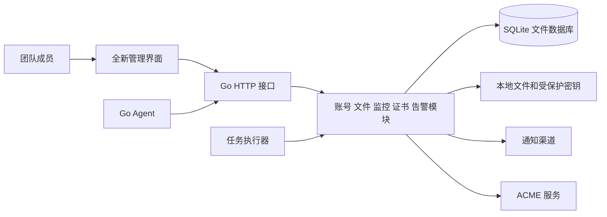

# 总体设计方案

> 文档类型：设计方案；包含已确认边界与待实施建议。当前使用方式以 [使用指南](README.md) 为准，公开发布流程见 [GitHub 发布指南](GITHUB.md)。

本项目建设可独立安装的开源监控运维平台，包含完整通用后台和监控业务。目标是让个人能快速部署、团队能协同使用、贡献者能按模块维护代码。

文档更新于 2026 年 10 月 14 日，已完成五类页面、远程 Agent、SMTP / Webhook 通知、菜单与文件管理、图片样式、基础设置及操作审计。实际实现边界见仓库 README；下文仍包含完整产品的后续规划。

## 已确认要求

| 项目 | 要求 |
|---|---|
| 部署模式 | 每个用户或公司自行部署一套 |
| 协作方式 | 一套安装内支持多个用户 |
| 数据边界 | 不做多租户 |
| 后端 | 使用 Go，明确接口类型和数据模型 |
| 数据库 | 仅使用内置 SQLite 文件数据库 |
| 前端 | React 19 界面、导航和操作流程 |
| 功能范围 | 监控业务和通用后台管理 |
| 项目目录 | 独立目录，所有运行依赖在本仓库内声明 |
| 版本管理 | 独立 Git 历史，公开源码仓库为 lorvanto/monitor-go |

不因开源用户数量未知而预设高并发容量。容量以每套安装中的主机数、检测目标数、采集频率、历史保留和浏览器并发为依据，通过测试说明适用范围。

## 建议方案

下列选型属于建议，实施前可以调整。

| 项目 | 建议 | 选择理由和边界 |
|---|---|---|
| 服务形态 | Go 模块化单体，单服务实例起步 | API、调度和通知在一个程序中，按业务分包 |
| HTTP | 标准库 `net/http`，少量显式中间件 | 固定路由、参数校验、认证、授权和日志直观可查 |
| 数据访问 | `database/sql` 与各模块的显式查询 | SQL 和事务可审查，事务边界由业务操作决定 |
| 数据库 | SQLite，已确认 | 数据保存在本地文件，不需要额外数据库服务 |
| 前端 | React 19、TypeScript、Vite | 全新页面结构和交互，类型约束支持长期维护 |
| UI 基础 | 当前采用自定义 React 组件、CSS 设计令牌与 Lucide 图标 | 当前未引入 Element Plus，正式组件库按后续复杂控件需求确定 |
| Agent | 一个 Go 程序，采集和探测按配置启用 | 主机采集与服务探测共用安装、身份、配置和升级机制 |
| 任务 | 程序内执行器加数据库任务记录 | 有界并发、幂等、租约、超时和重试 |
| 交付 | 嵌入前端的二进制、容器镜像 | 用户运行成品无需安装 Go 或 Node.js |

依赖版本在实际初始化时锁定受支持的稳定版本。SQLite 驱动建议使用无需 CGO 的 `modernc.org/sqlite`，发布前验证目标操作系统与架构。不实现多数据库适配层。[驱动文档](https://pkg.go.dev/modernc.org/sqlite)

Go 标准库提供 HTTP 服务和文件嵌入能力，`cmd` 与 `internal` 也符合官方对服务器项目的目录建议。[HTTP 文档](https://pkg.go.dev/net/http)、[文件嵌入文档](https://pkg.go.dev/embed)、[目录组织建议](https://go.dev/doc/modules/layout)

React 官方支持使用 Vite 创建 TypeScript 客户端应用。当前采用 React 19、Zustand 5 和 Vite 8，业务页面按需加载；构建结果由 Go 嵌入并提供，不需要 Node.js 生产服务。[React 官方指南](https://react.dev/learn/build-a-react-app-from-scratch)

## 功能分区

| 分区 | 内容 |
|---|---|
| 工作台 | 异常概览、待处理告警、到期证书、最近任务、首次使用引导 |
| 主机 | 主机列表、资源指标、磁盘、网络、离线状态、历史趋势 |
| 检测 | HTTP、TCP、MySQL、Redis、SSL 目标，分组，检测记录和统计 |
| 证书 | ACME 账号、申请订单、挑战验证、签发、续期、下载和部署说明 |
| 告警 | 告警事件、确认、静默、规则、维护窗口、通知渠道和投递记录 |
| Agent | 安装凭据、注册、能力、在线状态、绑定和凭据轮换 |
| 文件 | 目录、上传、预览、移动、下载、图片样式、存储配置 |
| 应用 | 接入应用、授权范围、凭据、安装包记录 |
| 系统 | 用户、角色权限、菜单、操作审计、设置、任务和运行信息 |

功能规划与已实现能力分开维护；未接入的功能不得返回虚假的成功结果。

## 架构关系



服务端同时提供 Web 页面和同源 API。开发时 Vite 通过代理访问服务，部署时由同一个入口提供页面与接口。生产 HTTPS 可由反向代理终止；受信代理范围必须显式配置。

个人部署与团队部署共享一套产品。预置角色降低首次使用成本，自定义角色覆盖团队差异。

## 模块组织

规划目录如下。目前已建立 `cmd/monitor/` 服务入口、`internal/app/` 按领域拆分的服务端文件、版本化 SQLite 初始化迁移和 `web/` 前端；其他完整产品目录仍按后续任务创建。

```text
monitor-go/
├── cmd/
│   ├── server/
│   └── agent/
├── internal/
│   ├── identity/        # 用户、会话、角色权限
│   ├── navigation/      # 菜单和页面注册
│   ├── files/           # 文件和存储
│   ├── applications/    # 应用接入和安装包
│   ├── monitoring/      # 目标、探测、历史
│   ├── hosts/           # 主机和指标
│   ├── agents/          # Agent 身份、注册和配置
│   ├── certificates/    # 证书和 ACME 订单
│   ├── alerting/        # 告警和通知
│   ├── jobs/            # 调度和执行记录
│   ├── settings/        # 设置与审计
│   └── platform/        # HTTP、数据库、时钟等少量公共能力
├── web/
├── migrations/          # SQLite 版本化迁移
├── deploy/
├── scripts/
└── docs/                # 按语言组织，目录和文件名使用英文
    ├── en-US/
    ├── zh-CN/
    ├── ja-JP/
    ├── ko-KR/
    └── zh-TW/
```

模块内按需要设置 `handler.go`、`service.go`、`store.go` 和具体模型。接口用于需要替换或测试的边界，不要求每个结构体都配接口和多层包装。HTTP、Agent 和后台任务调用同一组业务规则。

## 多人协作

首版建议资源在安装内共享，角色控制读、写、管理和敏感操作。创建人与修改人用于审计，不作为数据隔离条件。

通过 `version` 字段进行乐观并发控制：两名用户编辑同一资源时，后提交者收到冲突提示，并可重新加载或比较修改。禁止静默覆盖。

管理员至少保留一个有效账号；停用用户、修改密码、撤销角色授权要影响现有会话。角色变化不能依靠用户手动清缓存才生效。

按资源分组限制可见范围属于可能的后续需求，与多租户无关；首版先使用功能级授权，若确需部门或项目隔离，应在权限实施前补充设计。

## 数据和文件

SQLite 使用本地持久磁盘，建议 WAL、短事务和有界批量写入。WAL 允许读写并行，但每个数据库仍只有一个写入者，且不适合将文件放在跨机器共享文件系统上。[SQLite WAL 文档](https://www.sqlite.org/wal.html)

运行数据建议集中在 `data/`：数据库为 `data/monitor.db`，普通文件为 `data/uploads/`，受保护证书为 `data/certificates/`，本地主密钥为受限权限的 `data/secrets/`。部署包与运行数据分离，升级替换程序而保留数据目录。敏感数据默认文件权限和服务账号权限单独设置。

数据库由应用内的单写入通道协调，读取使用受控连接。一个数据目录只允许运行一个活动服务实例，使用启动锁防止误启动第二个写入进程。团队成员均通过 HTTP 服务访问，不直接共享数据库文件。

大体积文件位于受管理的存储目录；数据库保存元数据。证书私钥、ACME 账号密钥、监控凭据和通知密钥按敏感资料单独处理，不进入通用公开下载目录。

数据库由一套 SQLite 版本化迁移管理，创建数据库、应用迁移和初始化管理员都由程序提供。监控队列和告警投递状态也保存在 SQLite，无需外部 Redis 或消息队列。MySQL、Redis 只保留为被监控服务类型。

## 仓库与交付边界

- 源码、资源、测试和文档均在本仓库维护，构建不依赖相邻目录。
- 不提交真实配置、数据库、上传文件、证书或密钥。
- Go module 为 `github.com/lorvanto/monitor-go`，外部依赖通过锁定文件管理并保留许可证。
- 使用独立 SQLite 数据目录完成安装；升级与恢复需要通过隔离测试验证。

## 产品与发布决定

| 事项 | 当前建议 | 影响 |
|---|---|---|
| 正式名称和仓库地址 | 当前显示名 Monitor Go，公开源码仓库 lorvanto/monitor-go | 发布品牌、Go module 路径和安装地址 |
| 关于与版本 | 展示本项目版本，应用 API 授权单独管理 | 运行信息与访问权限职责清晰 |
| 数据迁移 | 首次安装使用新库，版本升级通过 SQLite 迁移执行 | 升级前完整备份并验证恢复 |
| 开源许可证 | 已选 Apache-2.0 | 项目许可证与第三方声明分别维护 |
| 界面风格 | 信息清晰的运维工具，支持明暗主题 | 原型评审后确定颜色、密度和导航细节 |

后续发布按目标平台验证结果确定支持范围，功能候选见路线图。
