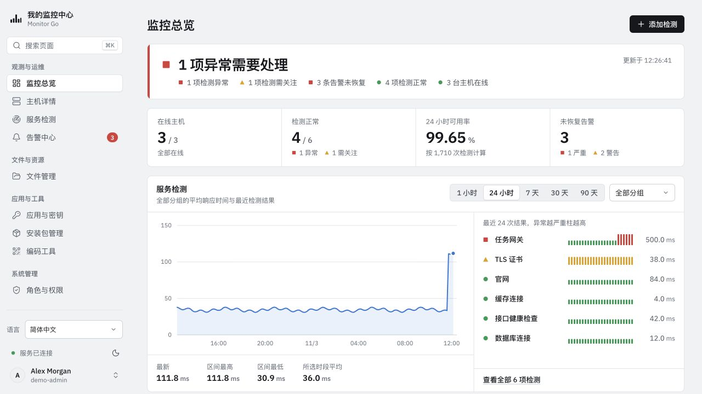
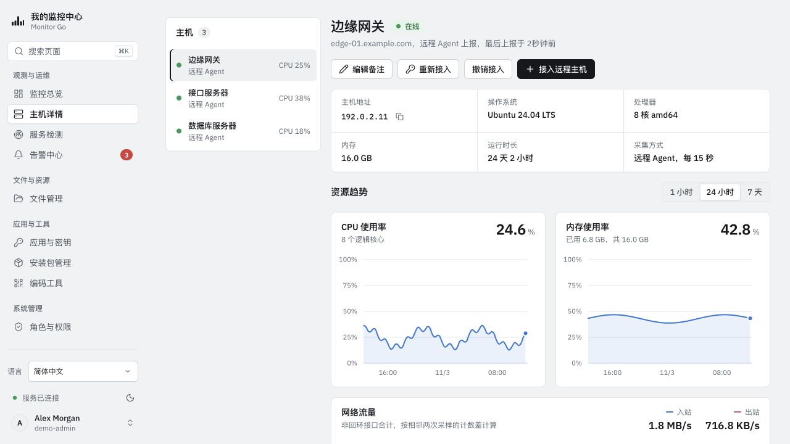
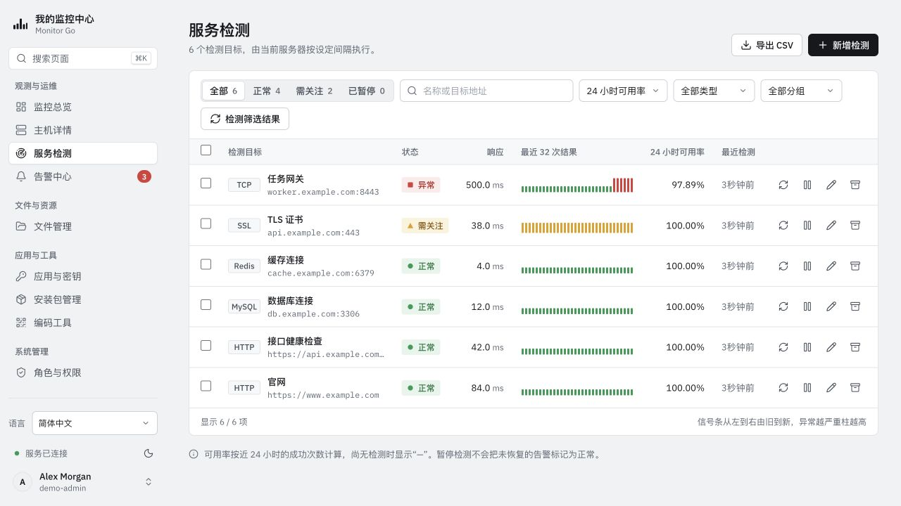
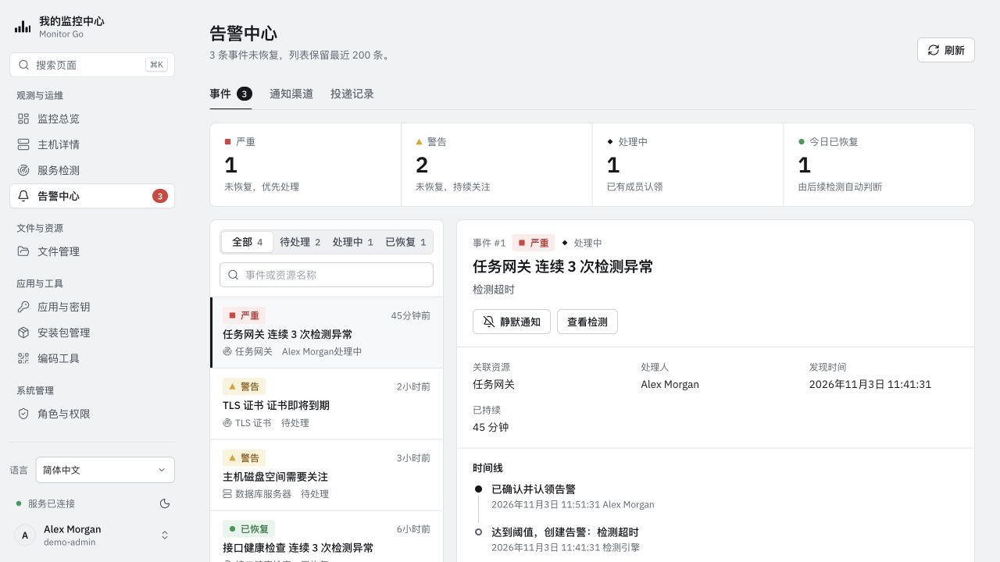
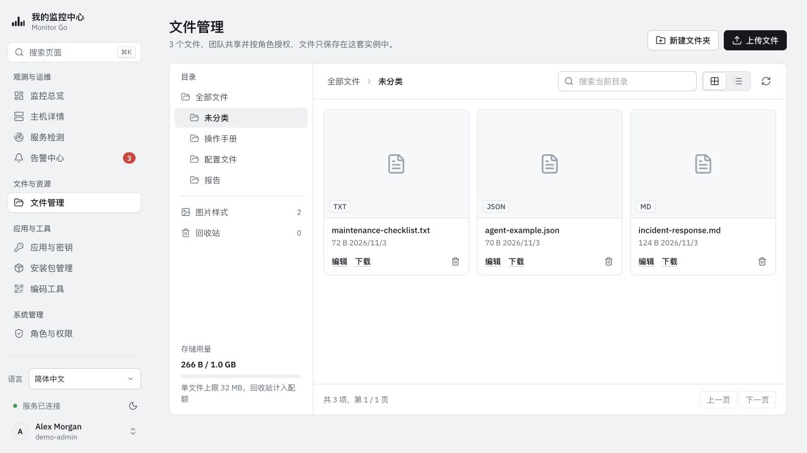
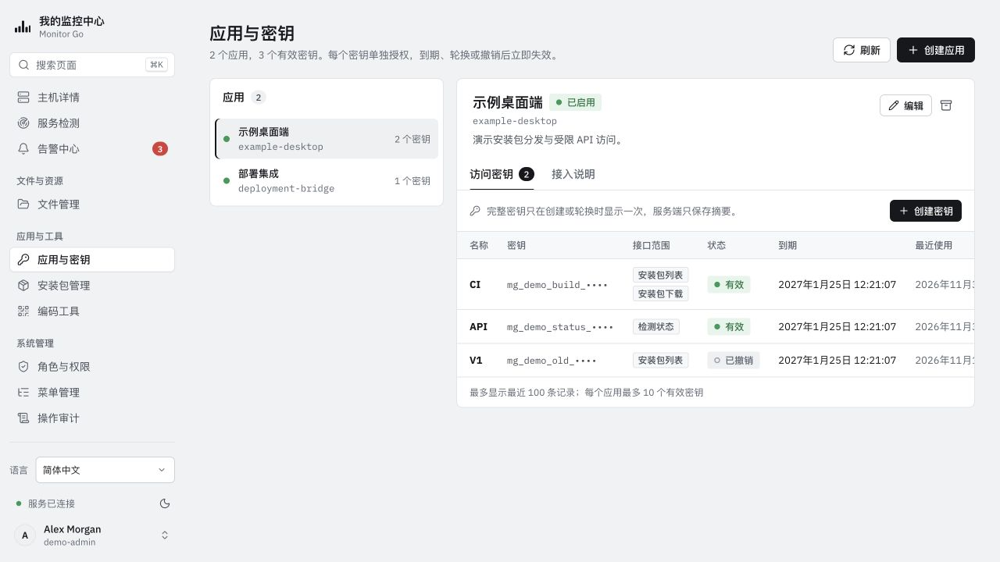
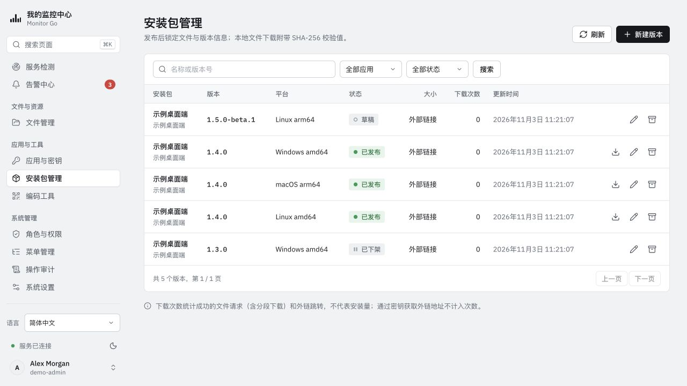
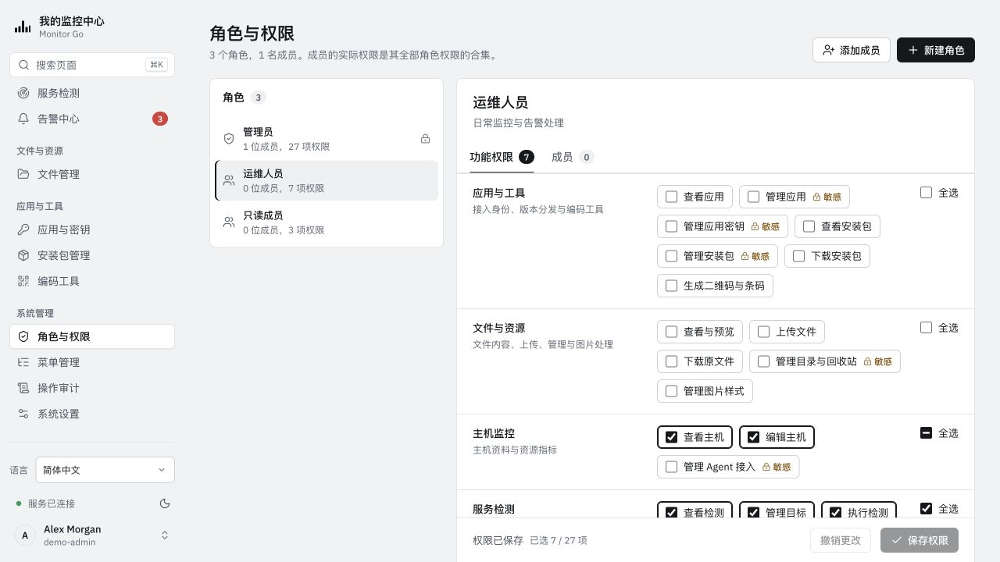
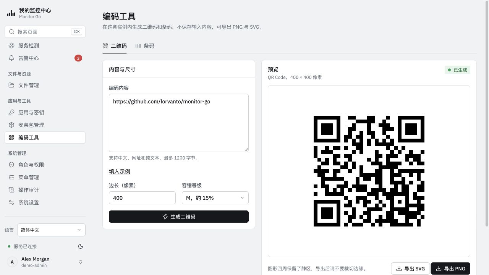

# Monitor Go — 界面截图

**简体中文** · [English](../en-US/SCREENSHOTS.md) · [日本語](../ja-JP/SCREENSHOTS.md) · [한국어](../ko-KR/SCREENSHOTS.md) · [繁體中文](../zh-TW/SCREENSHOTS.md)

以下为实际运行界面的简体中文截图，使用浅色主题和独立的合成演示数据。主机、应用、告警、文件及指标均为示例，不是真实监控结果或性能测试；密钥前缀不可用于访问，安装包记录不代表 Monitor Go 已发布版本。点击图片查看原图。

## 监控总览

## 主机详情

## 服务检测

## 告警中心

## 文件管理

## 应用与密钥

## 安装包管理

## 角色与权限

## 编码工具

[使用指南](README.md) · [截图维护与来源](../assets/screenshots/README.md)
