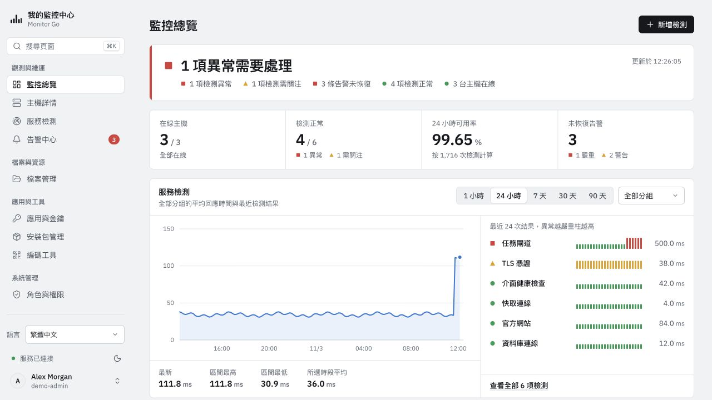
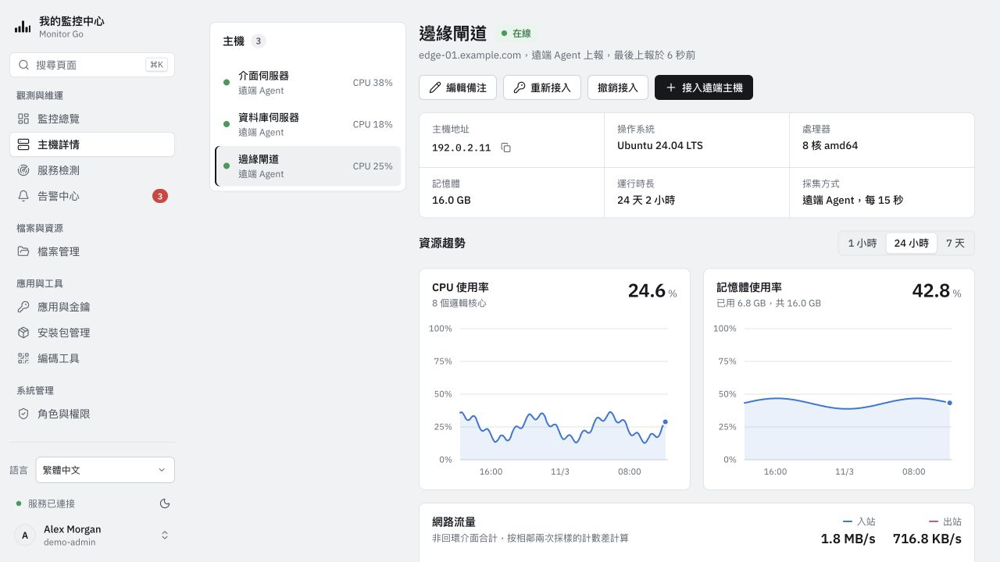
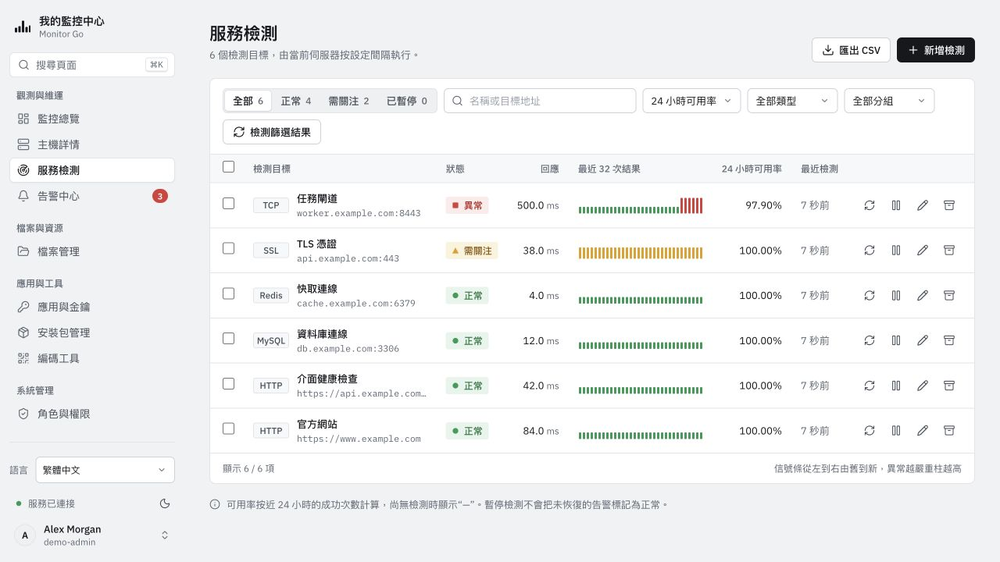
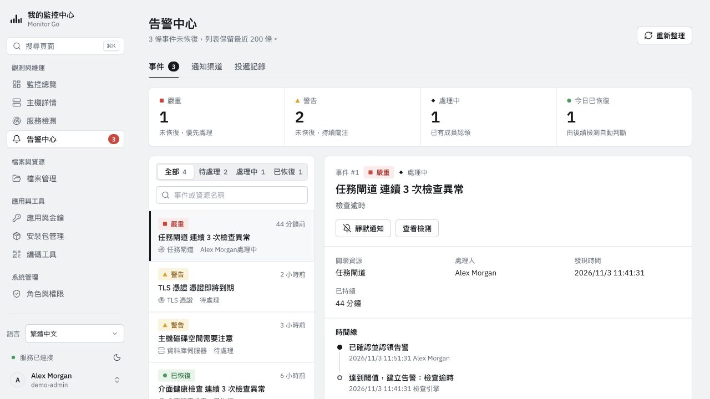
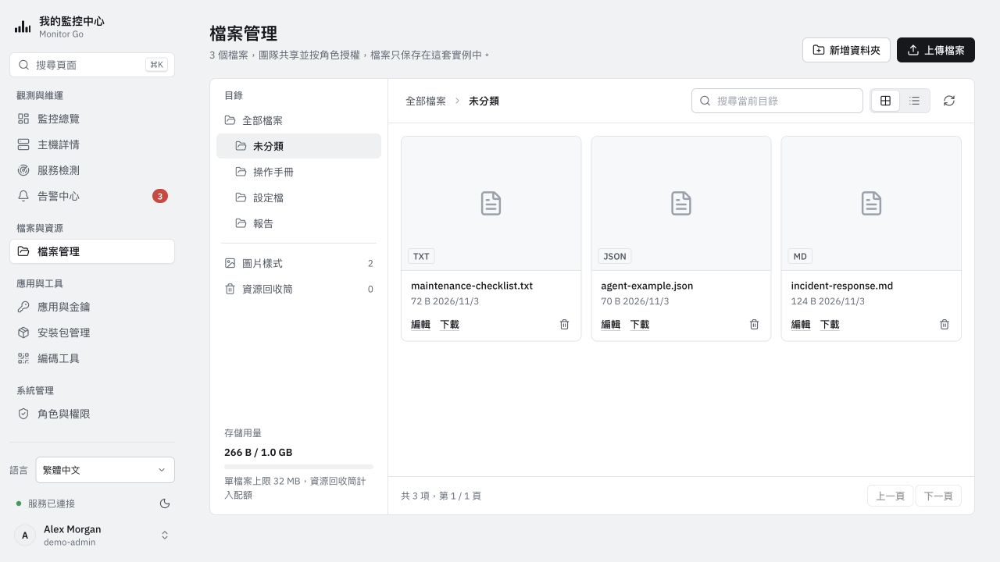
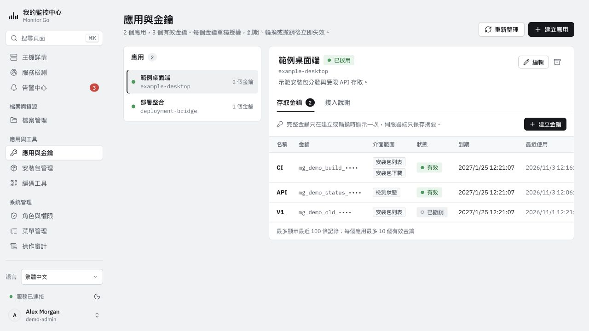
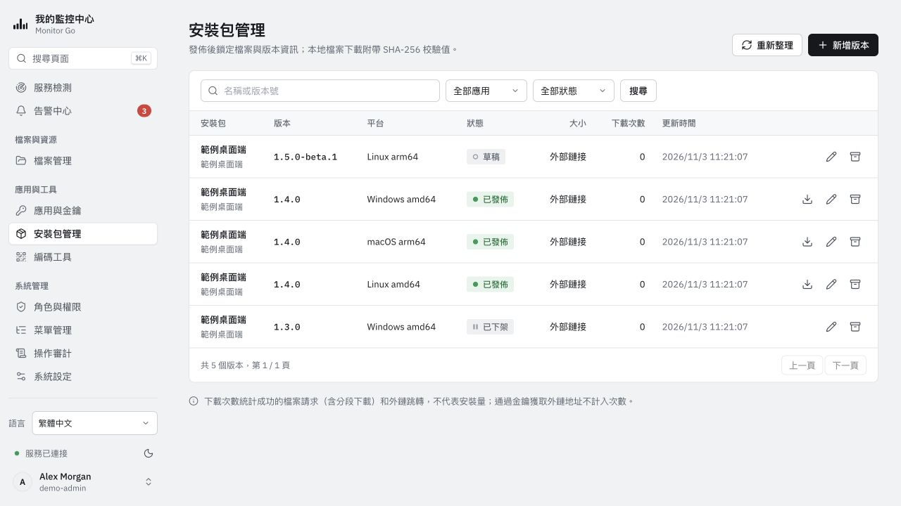
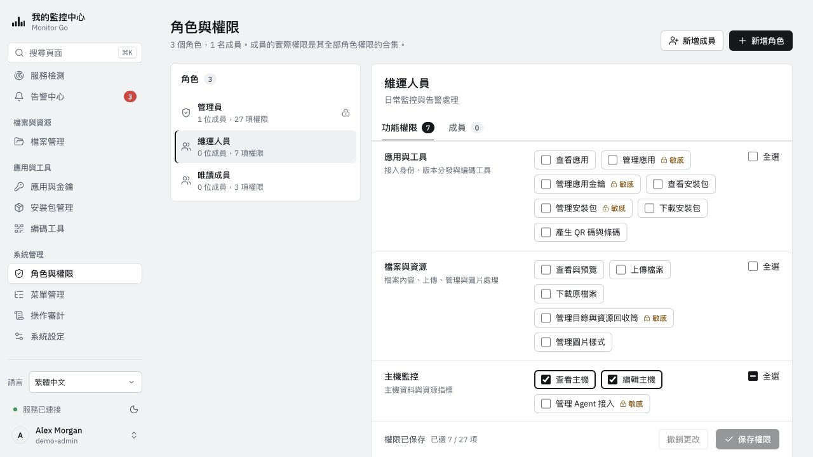
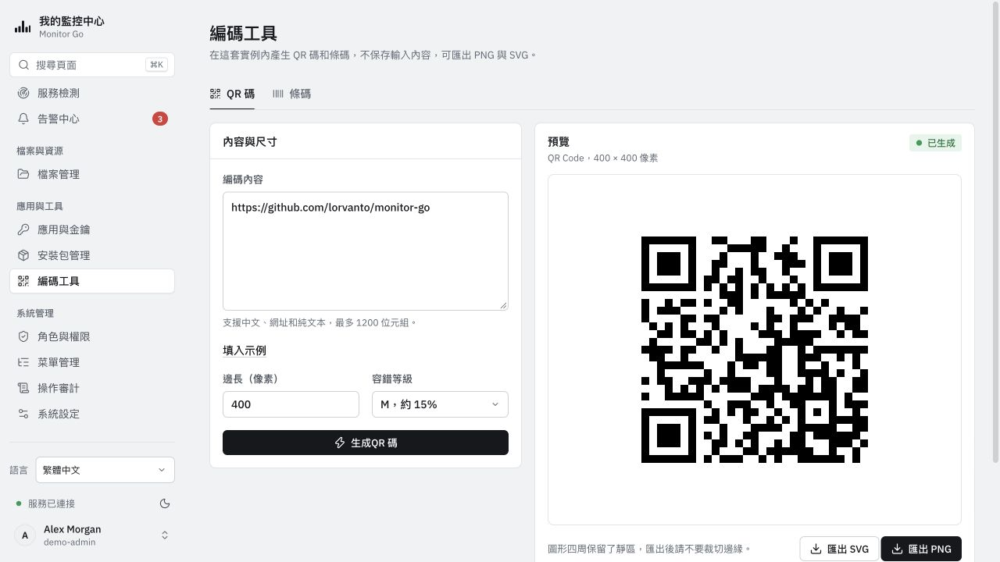

# Monitor Go — 介面截圖

[简体中文](../zh-CN/SCREENSHOTS.md) · [English](../en-US/SCREENSHOTS.md) · [日本語](../ja-JP/SCREENSHOTS.md) · [한국어](../ko-KR/SCREENSHOTS.md) · **繁體中文**

以下為實際執行介面的繁體中文截圖，使用淺色主題與獨立的合成示範資料。主機、應用程式、告警、檔案及指標均為範例，不是真實監控結果或效能測試；金鑰前綴不可用於存取，安裝套件記錄不代表 Monitor Go 已發佈版本。點選圖片查看原圖。

## 監控總覽

## 主機詳情

## 服務檢測

## 告警中心

## 檔案管理

## 應用程式與金鑰

## 安裝套件管理

## 角色與權限

## 編碼工具

[使用指南](README.md) · [截圖維護與來源](../assets/screenshots/README.md)
